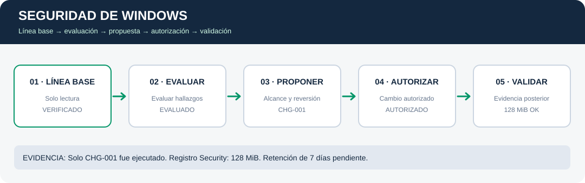

#  Ciberseguridad

  

[← Portafolio](../README.md) · [Evaluación de riesgos de seguridad de la información](../Information-Security/Enterprise-Risk-Assessment/README.md)

Mi trabajo en ciberseguridad parte de los sistemas que conozco desde soporte TI: estaciones Windows, identidades, registros de auditoría y cambios de configuración. Me interesa entender qué muestran las evidencias y qué controles pueden mejorar la seguridad sin interrumpir las operaciones.

## Evaluaciones documentadas

| Proyecto | Qué investigué | Resultado |
|---|---|---|
| **[Análisis de eventos de seguridad de Windows](Windows-Security-Event-Analysis/README.md)** | Correlación 4624/4672, auditoría de procesos y retención | **Investigación real de solo lectura** · Sin incidente confirmado |
| **[Evaluación de seguridad y hardening de Windows](Windows-Security-Hardening/README.md)** | Firewall, Defender, auditoría, PowerShell, BitLocker y arranque | **Evaluación real de 30 pasos** · Un cambio autorizado |
| **[Evaluación de riesgos empresariales](../Information-Security/Enterprise-Risk-Assessment/README.md)** | Inventario, registro de riesgos, controles y tratamiento | **Simulada** · Sin evaluación de controles reales |

## Dos investigaciones conectadas

La primera investigación permitió entender qué información ofrecía el registro Security y cómo sus limitaciones de retención y auditoría reducían la visibilidad. Después, el laboratorio de hardening amplió la evaluación de la línea base de Windows y documentó **CHG-001**, el cambio autorizado del límite máximo de Security de 20 MiB a 128 MiB.

## En desarrollo

El **monitoreo SIEM**, la **gestión de identidades y accesos** y la **respuesta a incidentes** son áreas en las que quiero profundizar. Los laboratorios dedicados a Wazuh e IAM están planificados; no los presento como implementaciones terminadas.

## Principios de trabajo

Prefiero cambios acotados y verificables, evidencias comprensibles y conclusiones que respeten el alcance de cada prueba. Un evento frecuente no es necesariamente seguro; uno con altos privilegios tampoco implica por sí solo actividad maliciosa. El contexto importa.

[← Volver al portafolio](../README.md)
