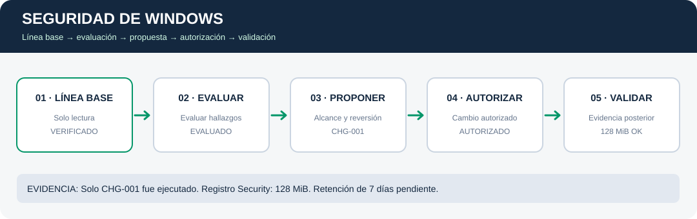
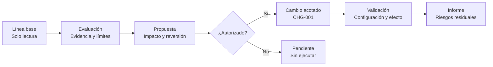

# Windows Security Hardening — Evaluación, mejoras y validación

**Área:** Ciberseguridad / Blue Team · Seguridad de endpoints  
**Estado:** **Evaluación finalizada: 28 comprobaciones reales y dos etapas de análisis/cierre (30 pasos)**.  
**Evidencia:** consultas reales y anonimizadas sobre Windows; **solo un cambio autorizado e implementado, CHG-001**.  
**Entorno:** estación de trabajo Windows, PowerShell y herramientas de seguridad integradas. No se requirieron nuevas máquinas virtuales.

[← Portafolio principal](../../README.md) · **[Guía detallada de los 30 pasos](docs/baseline-guide.md)** · [Matriz de evaluación y riesgos](docs/security-assessment.md) · [Plan de cambios y validación](docs/validation-plan.md) · [Investigación inicial de eventos](../Windows-Security-Event-Analysis/README.md)

## Resumen ejecutivo

Este laboratorio investiga el estado de controles de seguridad de Windows mediante **comprobaciones de solo lectura**, evaluación de riesgos y gestión disciplinada de cambios. Su objetivo es demostrar cómo analizar evidencia real sin atribuir incidentes no demostrados ni modificar controles sin autorización.

El trabajo comenzó a partir de una [investigación anterior de eventos de seguridad](../Windows-Security-Event-Analysis/README.md), que halló un registro Security de **20 MiB** y solo **2,03 días de historial observado**, además de la subcategoría **Creación del proceso: Sin auditoría**. Esas mediciones pertenecen al caso anterior y **no deben confundirse** con las nuevas instantáneas de este laboratorio.

## Resultados principales

| Área | Evidencia real | Evaluación |
|---|---|---|
| Windows Firewall | Perfiles Domain, Private y Public habilitados; en `ActiveStore`, entrada `Block` y salida `Allow` | Valores efectivos de perfil confirmados; reglas particulares no evaluadas |
| Microsoft Defender | Antivirus y protección en tiempo real activos; Tamper Protection y NIS `True`; firmas de antigüedad cero días | Indicadores favorables; no prueban eficacia completa |
| Protección avanzada | `MAPSReporting=2`, `SubmitSamplesConsent=1`, `PUAProtection=1`, `DisableBlockAtFirstSeen=False` | Preferencias comprobadas, sin prueba de detección |
| Auditoría de procesos | `Process Creation: No Auditing` | Posible brecha de visibilidad; cambio **solo propuesto** |
| Registro Security | **CHG-001: máximo de 20 MiB a 128 MiB**, manteniendo modo Circular | Único cambio ejecutado y validado en su configuración |
| Retención Security | **1,93 días antes; 1,96 días en validación inmediata posterior** | Meta propuesta de **7 días aún sin validar** |
| Cifrado BitLocker | C: `FullyDecrypted`, `Off`, `0 %` | Sin cifrado; cambio diferido hasta tener respaldos y recuperación |
| Seguridad de arranque | TPM preparado, UEFI y disco GPT; Secure Boot `False` | Secure Boot deshabilitado; sin modificación de firmware |
| PowerShell Operational | Activo; 808 registros, máximo 15 MiB, Circular; intervalo observado 5,05 días | Existe telemetría, pero no cobertura garantizada |
| Políticas PowerShell | Claves HKLM/HKCU de Script Block Logging, Module Logging y Transcription ausentes en las rutas inspeccionadas | No equivale a afirmar que toda la auditoría esté desactivada |
| Eventos PowerShell | 4104: 438 en una consulta y 439 advertencias posteriormente; 4103: 0 recuperados | Diferentes momentos de captura; no se comprobó un ataque |
| Auditoría de acceso | Logon: `Aciertos y errores`; 235 eventos 4624 en 24 horas, sin grupo 4625 | Política configurada y eventos exitosos existentes; no son usuarios únicos |
| Tipos de sesión | 4624 tipo 5: 229; tipo 11: 4; tipo 7: 2 | Predominan eventos de servicios (97,4 %) |
| Privilegios especiales | 233 eventos 4672 en 24 horas | Asignación de privilegios, **no uso indebido confirmado** |

Estas cifras provienen de consultas en momentos diferentes. No deben interpretarse como una misma secuencia forense ni como una certificación de cumplimiento.

## Ciclo de trabajo utilizado





El proyecto diferencia deliberadamente **observar, interpretar, proponer, autorizar, ejecutar y validar**. La ausencia de un ajuste no prueba por sí sola una vulnerabilidad; un control propuesto no constituye implementación.

## Cambio controlado CHG-001

**Problema:** el límite inicial del registro Security era 20 MiB. Se evaluó ampliar capacidad para conservar más eventos disponibles durante investigaciones.

**Autorización:** el propietario del equipo aprobó **únicamente** modificar el límite máximo de Security a 128 MiB.

**Comando realmente ejecutado:**

```powershell
wevtutil sl Security /ms:134217728
```

**Resultado verificado:**

```text
LogName            : Security
IsEnabled          : True
RecordCount        : 33989
MaximumSizeInBytes : 134217728
LogMode            : Circular
```

La configuración máxima pasó de **20 MiB a 128 MiB**, un aumento de 108 MiB; se verificó que el canal seguía habilitado y circular.

La consulta inmediata posterior encontró un intervalo de **1,96 días** entre eventos extremos, frente a **1,93 días** antes del cambio. **Esto no demuestra que ya conserve siete días de registros.** No se ejecutaron comandos de borrado ni una reversión durante las acciones documentadas.

[Consultar la evidencia, fechas y plan de validación de CHG-001](docs/validation-plan.md).

## Oportunidades y pendientes

- **Cifrado y arranque:** respaldar información, comprobar recuperación y compatibilidad antes de considerar BitLocker o Secure Boot. No realizar ajustes de firmware sin un plan de recuperación.
- **Retención:** volver a medir Security después de un intervalo suficiente; la capacidad de 128 MiB no garantiza la meta de siete días.
- **Auditoría de creación de procesos:** evaluar privacidad, volumen y necesidad antes de proponer una habilitación por cambio separado.
- **Telemetría PowerShell:** estudiar cobertura efectiva de Script Block, Module Logging y Transcription según política, edición y casos de detección. No se habilitaron esos controles.
- **Eventos 4624/4672:** establecer una línea base y correlacionar únicamente si hay motivos y autorización; los conteos por sí solos no confirman anomalías.

## Documentación del laboratorio

| Documento | Contenido |
|---|---|
| **[Guía de 30 pasos](docs/baseline-guide.md)** | Comandos realmente ejecutados, salidas observadas y explicación de cada resultado |
| **[Evaluación de seguridad](docs/security-assessment.md)** | Estado de controles, hallazgos, prioridades y límites |
| **[Plan de validación](docs/validation-plan.md)** | CHG-001, comprobaciones antes/después, riesgos de cambios y acciones pendientes |
| **[Caso Blue Team previo](../Windows-Security-Event-Analysis/README.md)** | Investigación que motivó el proyecto |

## Habilidades demostradas

- PowerShell y administración de Windows.
- Evaluación de controles de endpoint y monitoreo.
- Auditoría de eventos y autenticación.
- Diagnóstico de BitLocker, TPM, Secure Boot, UEFI y GPT.
- Clasificación de eventos 4103, 4104, 4624, 4625 y 4672.
- Gestión de cambios con autorización, evidencia y validación.
- Comunicación de riesgos, incertidumbre y medidas pendientes.

## Integridad y límites

**Caso real de laboratorio**, con evidencia suministrada por el propietario del equipo. No se realizó ataque controlado, prueba de explotación, atribución de usuarios, remediación integral ni certificación de seguridad.

La finalización de los 30 pasos significa que **la fase de evaluación y documentación está completada**, no que el endpoint cumpla un estándar empresarial de hardening.

## Referencias

- [Windows Security Baselines — Microsoft Learn](https://learn.microsoft.com/en-us/windows/security/operating-system-security/device-management/windows-security-configuration-framework/windows-security-baselines)
- [Security Compliance Toolkit](https://learn.microsoft.com/en-us/windows/security/operating-system-security/device-management/windows-security-configuration-framework/security-compliance-toolkit-10)
- [Get-NetFirewallProfile](https://learn.microsoft.com/en-us/powershell/module/netsecurity/get-netfirewallprofile)
- [Get-MpComputerStatus](https://learn.microsoft.com/en-us/powershell/module/defender/get-mpcomputerstatus)
- [auditpol /get](https://learn.microsoft.com/en-us/windows-server/administration/windows-commands/auditpol-get)

*Las referencias explican metodologías y controles; la evidencia real está documentada en la guía del laboratorio.*