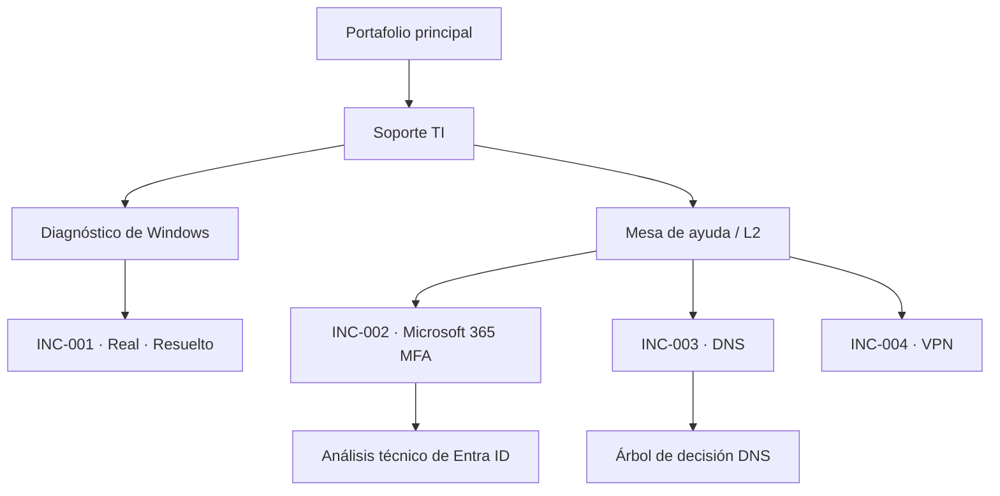

# Soporte TI y resolución de problemas

[← Portafolio principal](../README.md)

**Explora cuatro incidentes documentados en dos áreas de trabajo.** Esta página permite navegar por los casos de diagnóstico de Windows y por los escenarios de mesa de ayuda L2.

> **Identificación de casos:** `INC-001` a `INC-004` son identificadores del portafolio. No representan necesariamente tickets de una misma mesa de ayuda. Cada caso distingue claramente si es **real** o **simulado**.

## Rutas de navegación

| Área | Proyecto | Contenido | Evidencia |
|---|---|---|---|
| **[Diagnóstico de Windows](Windows-Troubleshooting-Lab/README.md)** | [INC-001 — Fallo de Windows Update](Windows-Troubleshooting-Lab/README.md) | PowerShell, eventos, almacenamiento y validación de la solución | **Real · Completado** |
| **[Gestión de incidentes de mesa de ayuda](Service-Desk-Incident-Management/README.md)** | [Casos L2](Service-Desk-Incident-Management/README.md) | Tres escenarios de identidad, DNS y VPN; investigación y escalamiento | **Simulados · Documentados** |

## Acceso directo a los incidentes

| ID | Caso | Área | Estado | Detalle |
|---|---|---|---|---|
| **[INC-001](Windows-Troubleshooting-Lab/README.md)** | Fallos de actualización de Windows y aplicaciones | Windows | **Real · Resuelto** | [Evidencia anonimizada](Windows-Troubleshooting-Lab/evidence/validation-notes.md) |
| **[INC-002](Service-Desk-Incident-Management/incidents/INC-002-M365-Authentication.md)** | Error de autenticación / MFA en Microsoft 365 | Mesa de ayuda L2 | **Simulado · No ejecutado** | [Análisis técnico de Entra ID](Service-Desk-Incident-Management/incidents/INC-002-Technical-Analysis.md) |
| **[INC-003](Service-Desk-Incident-Management/incidents/INC-003-DNS-Resolution.md)** | Fallo de resolución de DNS | Mesa de ayuda L2 | **Simulado · No ejecutado** | [Árbol de decisión DNS](Service-Desk-Incident-Management/incidents/INC-003-DNS-Decision-Tree.md) |
| **[INC-004](Service-Desk-Incident-Management/incidents/INC-004-VPN-Connectivity.md)** | VPN conectada sin acceso a recursos internos | Mesa de ayuda L2 | **Simulado · No ejecutado** | [Procedimiento diagnóstico](Service-Desk-Incident-Management/incidents/INC-004-VPN-Connectivity.md) |

## Flujo de navegación

## Evidencia destacada — INC-001

**Verificado:** el espacio disponible pasó de **18,6 GiB a 63,1 GiB**, y las actualizaciones de aplicaciones terminaron correctamente tras la limpieza y el reinicio. **No se logró aislar una única causa raíz.**

## Escenarios L2

Los tres casos de mesa de ayuda son ficticios. Incluyen comandos y criterios de escalamiento **propuestos**, no resultados de una operación empresarial real.

## Competencias demostradas

Soporte TI L1/L2 · Diagnóstico de Windows · PowerShell · Eventos de seguridad · Microsoft 365 / Entra ID · DNS · VPN · Priorización · Escalamiento · Documentación segura.

## Recomendación de lectura

Comienza con el [incidente real de Windows](Windows-Troubleshooting-Lab/README.md) para observar evidencias verificadas y continúa con los [escenarios L2](Service-Desk-Incident-Management/README.md) para evaluar el razonamiento diagnóstico y el manejo de incidentes.

[← Volver al portafolio](../README.md)

---

*No se publica información confidencial de clientes o empleadores. Los escenarios simulados están identificados como tales.*