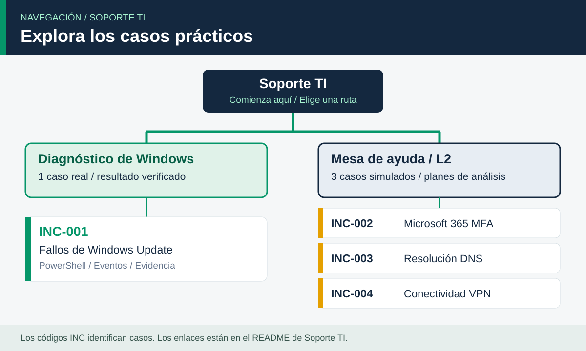
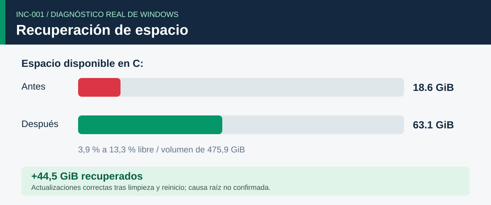
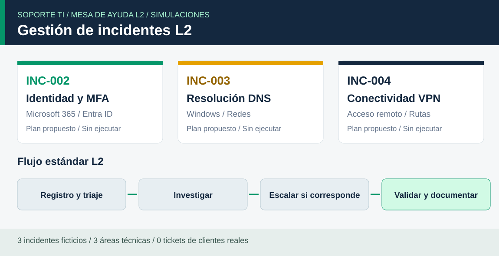

#  Soporte TI y diagnóstico

  

[← Portafolio](../README.md) · [Redes](../Networking/README.md) · [Documentación técnica](../Documentation/README.md)

Para diagnosticar bien un incidente, necesito delimitar el problema sin agravar la situación. Estos casos reúnen diagnóstico de Windows, priorización de incidentes, comunicación con usuarios y criterios de escalamiento seguros.

## Biblioteca de incidentes

| Caso | Qué ocurrió | Tipo |
|---|---|---|
| **[INC-001 · Windows Update](Windows-Troubleshooting-Lab/README.md)** | Fallos de actualización; limpieza y reinicio permitieron recuperar el funcionamiento | **Real · Resuelto** |
| **[INC-002 · Microsoft 365 MFA](Service-Desk-Incident-Management/incidents/INC-002-M365-Authentication.md)** | El usuario pierde acceso al método registrado después de cambiar su teléfono | **Simulado · Plan documentado** |
| **[INC-003 · Resolución DNS](Service-Desk-Incident-Management/incidents/INC-003-DNS-Resolution.md)** | Fallos de resolución de nombres pese a aparente conectividad IP | **Simulado · Plan documentado** |
| **[INC-004 · Conectividad VPN](Service-Desk-Incident-Management/incidents/INC-004-VPN-Connectivity.md)** | La VPN indica conexión, pero los recursos internos no responden | **Simulado · Plan documentado** |

*Los identificadores INC-001 a INC-004 pertenecen al portafolio; no representan tickets de una misma mesa de ayuda real.*

## Evidencia de diagnóstico real

La investigación de Windows registró el error `0x80073D02`, una recuperación de aproximadamente **44,5 GiB** y la actualización correcta de aplicaciones después de limpiar espacio y reiniciar. El problema se resolvió; su causa exacta permanece incierta.

[Leer INC-001 y sus evidencias anonimizadas](Windows-Troubleshooting-Lab/README.md)

## Escenarios de mesa de ayuda L2

Los tres casos L2 muestran cómo abordar incidentes de autenticación, DNS y VPN desde el primer reporte hasta la investigación y el escalamiento. Describen **procedimientos propuestos**, no pruebas realizadas en sistemas de clientes.

[Explorar los casos L2](Service-Desk-Incident-Management/README.md)

## Competencias aplicadas

**Windows 11 · PowerShell · Visor de eventos · Microsoft 365 / Entra ID · DNS · VPN · Gestión de incidentes alineada con ITIL · Escalamiento · Validación**

[← Volver al portafolio](../README.md)
