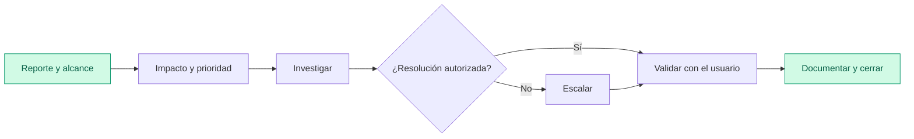

#  Mesa de ayuda L2 · Casos de incidentes

  

[← Soporte TI](../README.md) · [Portafolio](../../README.md)

Tres escenarios de incidentes exploran situaciones que pueden llegar al soporte de segundo nivel: pérdida de acceso MFA, problemas de resolución DNS y sesiones VPN conectadas sin acceso a servicios internos.

**Son casos ficticios.** Los pasos diagnósticos son propuestas y no se ejecutaron en sistemas de clientes.

## Casos y análisis técnicos

| Incidente | Pregunta principal | Material relacionado |
|---|---|---|
| **[INC-002 · Autenticación en Microsoft 365](incidents/INC-002-M365-Authentication.md)** | ¿El fallo está en MFA, la cuenta o los requisitos de acceso condicional? | [Análisis de inicio de sesión en Entra ID](incidents/INC-002-Technical-Analysis.md) |
| **[INC-003 · Resolución DNS](incidents/INC-003-DNS-Resolution.md)** | ¿El problema está en el cliente, el servidor DNS o la ruta hacia el servicio? | [Árbol de decisión DNS](incidents/INC-003-DNS-Decision-Tree.md) |
| **[INC-004 · Conectividad VPN](incidents/INC-004-VPN-Connectivity.md)** | ¿El túnel permite llegar efectivamente a los recursos internos? | [Procedimiento de diagnóstico VPN](incidents/INC-004-VPN-Connectivity.md) |

## Cómo se gestionan los casos

La verificación de identidad, el mínimo privilegio y los criterios de escalamiento forman parte del diagnóstico. No son controles que debamos eludir para recuperar un servicio.

## Documentación

La [plantilla de informe de incidente](templates/incident-report-template.md) permite registrar impacto, investigación, cambios propuestos, criterios de validación y comunicación con usuarios.

**Alcance:** un procedimiento bien documentado no equivale a una resolución verificada en producción. Los resultados de estos escenarios no se presentan como tickets reales de clientes.

[← Soporte TI](../README.md)
