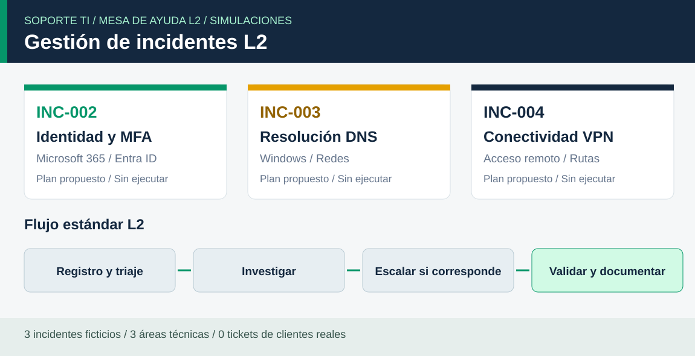

# Gestión de incidentes de mesa de ayuda — Casos L2

[← Soporte TI](../README.md) · [Portafolio principal](../../README.md)

**Alcance:** tres escenarios ficticios de incidentes L2. Se documentan planes de diagnóstico y escalamiento, **no acciones ejecutadas**.

> **Simulación del portafolio:** los incidentes y organizaciones descritos son ficticios. Los casos demuestran una metodología técnica, pero no representan tickets reales de clientes.

## Presentación del proyecto

Este proyecto demuestra un enfoque estructurado de **gestión de incidentes de mesa de ayuda**, soporte de segundo nivel (L2), diagnóstico técnico, priorización, conciencia de seguridad y documentación profesional.

El proceso sigue prácticas alineadas con **ITIL 4**, priorizando la restauración del servicio, la evaluación del impacto en el negocio y la comunicación con usuarios y equipos responsables.

## Objetivos

- Registrar y clasificar incidentes de TI.
- Evaluar impacto, urgencia y prioridad.
- Aplicar métodos estructurados de troubleshooting.
- Identificar riesgos de seguridad asociados.
- Definir criterios de resolución y escalamiento.
- Demostrar comunicación técnica profesional.

## Escenarios

| Incidente | Descripción | Tecnología | Estado |
|---|---|---|---|
| [INC-002](incidents/INC-002-M365-Authentication.md) | Error de autenticación en Microsoft 365 | Microsoft 365 / Entra ID | Documentado · Simulado |
| [INC-003](incidents/INC-003-DNS-Resolution.md) | Fallo de resolución de nombres | Windows / DNS / Redes | Documentado · Simulado |
| [INC-004](incidents/INC-004-VPN-Connectivity.md) | Fallo de acceso a través de VPN | VPN / Acceso remoto | Documentado · Simulado |

## Análisis técnicos complementarios

- [INC-002 — Análisis de inicios de sesión en Entra ID](incidents/INC-002-Technical-Analysis.md)
- [INC-003 — Árbol de decisión de DNS](incidents/INC-003-DNS-Decision-Tree.md)
- [Plantilla reutilizable de informe de incidente](templates/incident-report-template.md)

## Flujo de gestión de incidentes

1. **Registro:** recibir el reporte y recopilar antecedentes.
2. **Clasificación y prioridad:** evaluar impacto, urgencia y consecuencias para el negocio.
3. **Investigación y diagnóstico:** formular hipótesis y realizar comprobaciones autorizadas.
4. **Escalamiento:** involucrar equipos especializados cuando corresponda.
5. **Resolución y validación:** registrar medidas correctivas y comprobar la recuperación del servicio.
6. **Cierre:** documentar conclusiones, comunicación con el usuario y acciones preventivas.

## Competencias demostradas

- Soporte TI L1/L2.
- Gestión de incidentes alineada con ITIL 4.
- Microsoft 365 e identidades.
- Diagnóstico de redes, DNS y VPN.
- Documentación y comunicación técnica.
- Escalamiento y análisis preliminar de causa raíz.
- Seguridad operativa y mínimo privilegio.

## Limitaciones

Este proyecto utiliza **escenarios corporativos simulados**. Los procedimientos y soluciones propuestos no fueron validados en producción y deben probarse únicamente en sistemas autorizados.

## Referencias oficiales

- [ITIL 4 — PeopleCert](https://www.peoplecert.org/browse-certifications/it-governance-and-service-management/ITIL-1)
- [Registros de inicio de sesión de Microsoft Entra](https://learn.microsoft.com/en-us/entra/identity/monitoring-health/concept-sign-ins)
- [Resolve-DnsName — PowerShell](https://learn.microsoft.com/en-us/powershell/module/dnsclient/resolve-dnsname)

*Las referencias respaldan la metodología, pero no constituyen evidencia de ejecución ni de eficacia de controles.*