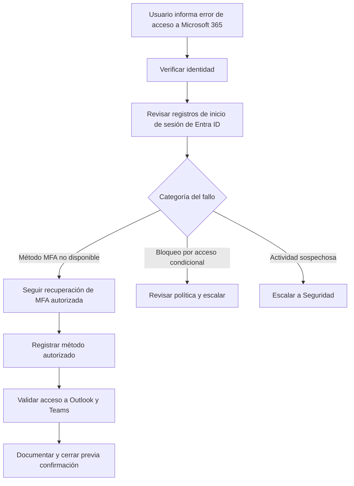

# INC-002 — Fallo de autenticación en Microsoft 365

[← Mesa de ayuda](../README.md) · [Soporte TI](../../README.md) · [Portafolio](../../../README.md)

**Tipo:** Error de autenticación de usuario  
**Categoría:** Gestión de identidades y accesos (IAM)  
**Prioridad:** P3 — Media (provisional, sujeta al impacto y SLA)  
**Nivel de soporte:** Mesa de ayuda L2  
**Entorno:** Microsoft 365 / Microsoft Entra ID  
**Estado:** Simulado — Plan de investigación y resolución

## Flujo de recuperación de autenticación

> **Simulación:** flujo diagnóstico propuesto. No se accedió a un tenant real de Microsoft 365 ni a registros de inicio de sesión. MFA y Conditional Access no deben deshabilitarse como atajo.

## 1. Descripción del incidente

Un empleado ficticio informa que no puede acceder a Outlook ni a Microsoft Teams después de cambiar su teléfono. Puede iniciar sesión en su estación de trabajo Windows, pero no logra completar la autenticación de Microsoft 365.

**Error informado:** «No se pudo completar la solicitud de autenticación».

## 2. Impacto en el negocio

- Un empleado no puede acceder a Microsoft 365.
- Se interrumpen el correo y las herramientas de colaboración.
- No se ha informado una interrupción generalizada.
- El equipo Windows sigue operativo.

**Prioridad inicial:** P3 — Media, suponiendo impacto normal sobre una sola persona y sin actividad crítica inmediata.

## 3. Diagnóstico inicial

El técnico L2 debe:

1. Verificar la identidad mediante un procedimiento autorizado.
2. Identificar las aplicaciones afectadas y el error específico.
3. Confirmar si comenzó tras el cambio de teléfono.
4. Revisar el estado de la cuenta en Microsoft Entra ID.
5. Consultar los registros de inicio de sesión.
6. Evaluar si el fallo corresponde a MFA, Conditional Access u otro requisito.
7. Comprobar si existe otro método de autenticación registrado.

## 4. Hipótesis

**Hipótesis principal:** el registro de Microsoft Authenticator corresponde al teléfono anterior y el empleado no dispone de él para completar MFA.

**Causas alternativas:** requisitos de acceso condicional; cuenta bloqueada o deshabilitada; registro incorrecto de métodos de autenticación; interrupción temporal del servicio.

**Causa raíz:** no confirmada. Requiere evidencia de los registros de inicio de sesión.

## 5. Resolución propuesta

Si la evidencia confirma que el usuario perdió acceso al método registrado:

1. Completar la verificación de identidad exigida por la organización.
2. Aplicar el proceso autorizado de recuperación de MFA.
3. Si está permitido, utilizar un Temporary Access Pass (TAP) o un flujo aprobado de reinscripción.
4. Registrar Microsoft Authenticator en el nuevo dispositivo.
5. Confirmar que MFA funciona correctamente.
6. Verificar acceso a Outlook y Teams.
7. Documentar las acciones y comunicar el resultado.

**Seguridad:** no deshabilitar MFA ni omitir Conditional Access para recuperar el acceso. Escalar cualquier solicitud fuera del procedimiento aprobado.

## 6. Criterios de validación

El incidente podría cerrarse cuando se cumplan todas estas condiciones:

- El usuario se autentica correctamente.
- El método MFA queda registrado y funcional.
- Outlook y Teams son accesibles.
- El usuario confirma la recuperación del servicio.
- El ticket incluye el diagnóstico, la recuperación y la evidencia correspondiente.

## 7. Criterios de escalamiento

Escalar al equipo de Identidades o Seguridad si se detectan intentos sospechosos, si el usuario no supera la verificación de identidad, si se requiere cambiar Conditional Access, si se sospechan modificaciones MFA no autorizadas o si el técnico carece de permisos.

## 8. Cierre del incidente

**Resultado:** no ejecutado; caso simulado.  
**Solución propuesta:** recuperar mediante el procedimiento autorizado el método MFA y validar el acceso.  
**Causa raíz:** hipótesis de registro o disponibilidad de MFA; no verificada.

**Lecciones aprendidas:** validar identidad antes de recuperar MFA, utilizar registros de autenticación para diferenciar causas y documentar adecuadamente cambios y escalamiento.

## Advertencia sobre la simulación

No se modificó ninguna cuenta real ni se ejecutaron acciones de recuperación en producción.

## Referencias oficiales

- [Métodos de autenticación en Microsoft Entra](https://learn.microsoft.com/en-us/entra/identity/authentication/concept-authentication-methods-manage)
- [Registros de inicio de sesión](https://learn.microsoft.com/en-us/entra/identity/monitoring-health/concept-sign-ins)
- [Conditional Access](https://learn.microsoft.com/en-us/entra/identity/conditional-access/overview)

*Las referencias documentan prácticas técnicas; no prueban ejecución ni eficacia en este caso.*