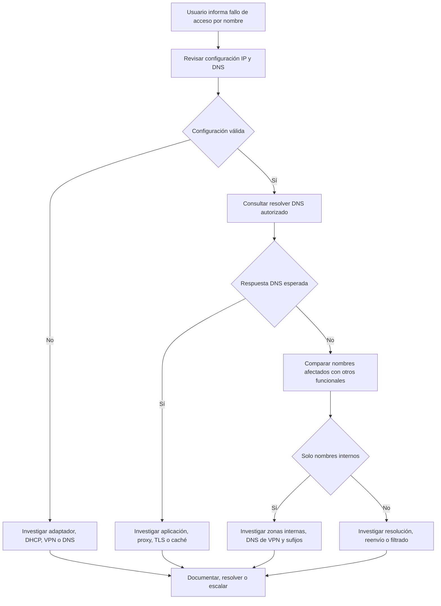

# INC-003 — Árbol de decisión para diagnóstico de DNS

[← INC-003](INC-003-DNS-Resolution.md) · [Mesa de ayuda](../README.md) · [Soporte TI](../../README.md)

**Incidente relacionado:** [INC-003 — Fallo corporativo de DNS](INC-003-DNS-Resolution.md)  
**Nivel de soporte:** L2  
**Estado:** Simulado — referencia diagnóstica; no ejecutado

## Flujo diagnóstico

## Guía de decisiones

| Comprobación | Comando | Interpretación |
|---|---|---|
| Configuración del cliente | `ipconfig /all` | Revisar IP, gateway, servidores DNS y sufijos |
| Resolución de nombres | `Resolve-DnsName www.microsoft.com` | Comprobar respuesta del resolver configurado |
| Comparación autorizada | `Resolve-DnsName www.microsoft.com -Server <APPROVED_DNS_IP>` | Comparar solo con un servidor autorizado |
| Conectividad TCP al servicio DNS | `Test-NetConnection <APPROVED_DNS_IP> -Port 53` | Comprueba TCP 53; DNS también utiliza UDP, por lo que un fallo no es concluyente |
| Caché de DNS | `ipconfig /displaydns` | Revisar resultados antes de considerar vaciar la caché |

Reemplazar los marcadores con direcciones permitidas por la organización. **No enviar nombres internos a resolvers públicos no autorizados.**

## Escalamiento

Escalar cuando el DNS corporativo esté indisponible, afecte a varias personas, se requieran cambios de zona o reenvío, o intervengan controles de seguridad.

## Evidencia y limitaciones

Se trata de un flujo diagnóstico **propuesto**, no de una bitácora de comandos ejecutados. Los resultados reales y la validación de cualquier corrección deberán recopilarse en un entorno autorizado.

## Referencias oficiales

- [Resolve-DnsName](https://learn.microsoft.com/en-us/powershell/module/dnsclient/resolve-dnsname)
- [Test-NetConnection](https://learn.microsoft.com/en-us/powershell/module/nettcpip/test-netconnection)
- [DNS en Windows Server](https://learn.microsoft.com/en-us/windows-server/networking/dns/dns-overview)

*Las referencias respaldan el método, no la ejecución de pruebas de este escenario.*