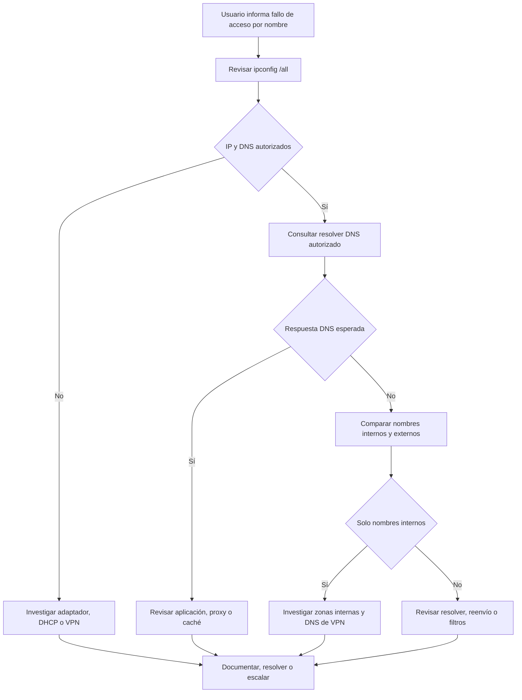

# INC-003 — Fallo de resolución de DNS corporativo

[← Mesa de ayuda](../README.md) · [Soporte TI](../../README.md) · [Portafolio](../../../README.md)

**Tipo:** Conectividad de red / Resolución DNS  
**Categoría:** Redes  
**Prioridad:** P3 — Media (propuesta; sujeta al SLA corporativo)  
**Nivel:** Mesa de ayuda L2  
**Entorno:** Windows 11 Enterprise / Red corporativa  
**Estado:** Simulado — Plan de investigación y resolución

## Flujo de troubleshooting DNS



> **Simulación:** los nodos muestran decisiones propuestas, no pruebas realizadas. Solo se deben usar servidores DNS autorizados y mantener los controles corporativos de seguridad.

## 1. Descripción del incidente

Un empleado ficticio informa que no puede acceder a aplicaciones web corporativas ni a algunos sitios externos utilizando sus nombres de dominio. El equipo parece mantener conectividad IP, pero se sospecha un problema de resolución DNS.

**Síntomas informados:**

- Las aplicaciones internas no cargan por nombre.
- Algunos sitios muestran errores de DNS.
- El equipo permanece conectado a la red corporativa.
- No se ha confirmado una interrupción generalizada.

## 2. Impacto en el negocio

- Un empleado pierde acceso a aplicaciones necesarias.
- Disminuye su productividad.
- La conectividad parece funcionar parcialmente.
- Debe comprobarse el alcance del incidente.

**Prioridad inicial:** P3 — Media, suponiendo un único usuario afectado y sin interrupción crítica.

## 3. Diagnóstico inicial

### Paso 1 — Revisar configuración de red

```cmd
ipconfig /all
```

**Objetivo:** identificar dirección IP, máscara, puerta de enlace y servidores DNS configurados.

**Resultado esperado:** configuración IP válida; servidores DNS coherentes con la red; adaptadores sin cambios inesperados.

**Estado de ejecución:** no probado.

### Paso 2 — Comprobar conectividad IP

```cmd
ping 1.1.1.1
```

**Objetivo:** evaluar conectividad hacia una dirección externa sin depender del DNS.

Una respuesta correcta indica conectividad IP básica con el destino. Un error **no es concluyente** porque el tráfico ICMP puede estar filtrado.

**Estado:** no probado.

### Paso 3 — Probar resolución DNS

```cmd
nslookup www.microsoft.com
```

**Objetivo:** comprobar si el resolver configurado resuelve un dominio externo conocido.

**Posibles resultados:** respuesta correcta, tiempo de espera agotado, servidor indisponible o respuesta desde un servidor inesperado.

**Estado:** no probado.

### Paso 4 — Comparar resolvers DNS

```cmd
nslookup www.microsoft.com 1.1.1.1
```

Comparar con un servidor DNS público **solo si lo permite la política corporativa**. La organización puede bloquear o prohibir resolvers públicos.

**Estado:** no probado.

### Paso 5 — Revisar caché del cliente

```cmd
ipconfig /displaydns
```

Permite identificar entradas potencialmente desactualizadas. Si es apropiado y autorizado, podría ejecutarse:

```cmd
ipconfig /flushdns
```

**Importante:** vaciar la caché es una medida correctiva, no una prueba de que la caché haya causado el problema.

**Estado:** no probado.

### Paso 6 — Diagnóstico DNS mediante PowerShell

```powershell
Resolve-DnsName www.microsoft.com
```

También podría consultarse un servidor específico si está autorizado:

```powershell
Resolve-DnsName www.microsoft.com -Server 1.1.1.1
```

**Estado:** no probado.

## 4. Análisis de posibles causas

Se plantearon las siguientes hipótesis:

1. Configuración incorrecta del servidor DNS.
2. Indisponibilidad del servidor DNS.
3. Inconsistencias en la caché local.
4. Problemas de DNS relacionados con VPN.
5. Filtrado DNS o restricciones de seguridad.

**Causa raíz confirmada:** no establecida. Es imprescindible contar con resultados diagnósticos reales para determinarla.

## 5. Resolución propuesta

Según la evidencia obtenida:

1. Comparar la configuración con los parámetros corporativos aprobados.
2. Verificar acceso y disponibilidad de los servidores DNS.
3. Revisar DNS de VPN si el usuario trabaja remotamente.
4. Vaciar caché únicamente cuando corresponda.
5. Corregir configuraciones erróneas mediante un procedimiento autorizado.
6. Escalar problemas de infraestructura DNS al equipo de Redes o Infraestructura.

## 6. Criterios de validación

El incidente podría cerrarse cuando:

- Se resuelven los nombres de recursos afectados.
- El usuario accede a las aplicaciones necesarias.
- Los servidores autorizados entregan las respuestas esperadas.
- No quedan cambios no deseados en la configuración.
- El usuario confirma la recuperación del servicio.

**Validación:** no ejecutada.

## 7. Criterios de escalamiento

Escalar si varios usuarios presentan el mismo problema; los servidores DNS corporativos están indisponibles; se necesitan cambios de reenvío o zonas; intervienen controles de seguridad; o la corrección supera los permisos L2.

## 8. Consideraciones de seguridad

- No sustituir servidores DNS internos por resolvers públicos sin autorización.
- No revelar nombres de dominios internos a servicios externos no aprobados.
- Documentar cualquier cambio en la configuración.
- Investigar servidores DNS inesperados.
- Escalar sospechas de manipulación o envenenamiento de DNS.

## 9. Cierre

**Resultado:** escenario no ejecutado.  
**Resolución propuesta:** identificar el componente DNS afectado, aplicar una corrección autorizada y validar la resolución.  
**Causa raíz:** no confirmada.

**Lecciones aprendidas:** la conectividad IP y DNS deben analizarse por separado; la configuración debe verificarse antes de modificarla; los resolvers públicos son una opción diagnóstica solo cuando están permitidos; la documentación estructurada facilita el escalamiento.

## Advertencia sobre la simulación

No se modificó ningún DNS de producción ni se ejecutaron comandos para este caso.

## Referencias oficiales

- [Resolve-DnsName](https://learn.microsoft.com/en-us/powershell/module/dnsclient/resolve-dnsname)
- [Módulo DnsClient](https://learn.microsoft.com/en-us/powershell/module/dnsclient)
- [Fundamentos de DNS](https://learn.microsoft.com/en-us/windows-server/networking/dns/dns-overview)

*Las referencias respaldan el procedimiento técnico, no demuestran su ejecución.*