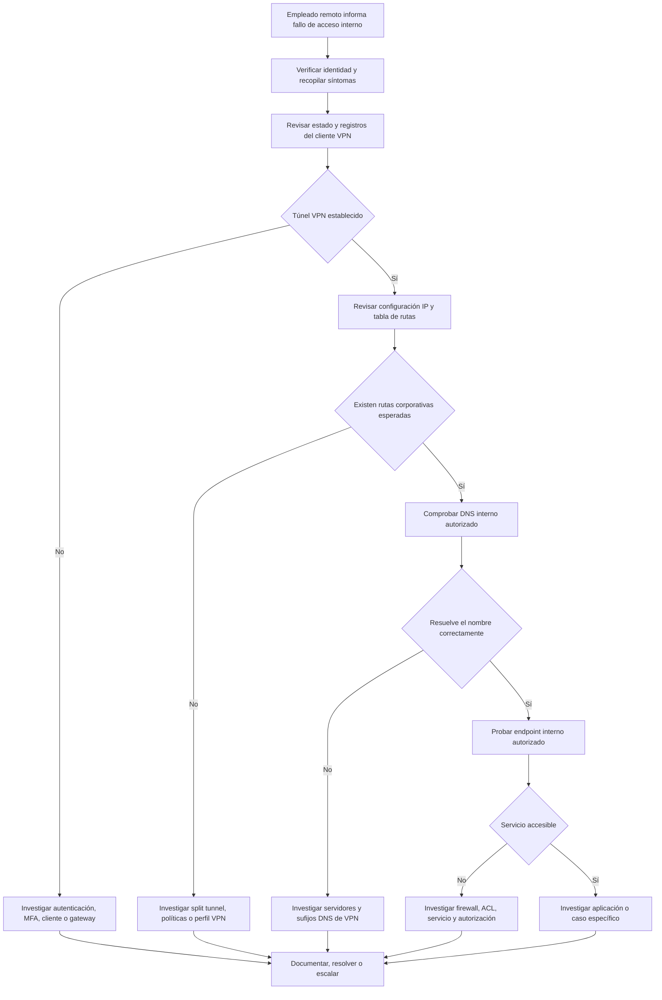

# INC-004 — Fallo de conectividad mediante VPN corporativa

[← Mesa de ayuda](../README.md) · [Soporte TI](../../README.md) · [Portafolio](../../../README.md)

**Tipo:** Acceso remoto / Conectividad de red  
**Categoría:** Redes y acceso remoto  
**Prioridad:** P3 — Media, provisional según impacto y SLA  
**Nivel:** Mesa de ayuda L2  
**Entorno:** Windows 11 / VPN corporativa / Aplicaciones internas  
**Estado:** Simulado — Plan de investigación y resolución

> **Simulación:** caso ficticio de soporte técnico. No se accedió a ninguna VPN, red corporativa ni cuenta de usuario real.

## Resumen del incidente

| Campo | Descripción |
|---|---|
| ID | INC-004 |
| Reportado por | Empleado remoto ficticio |
| Síntoma | La VPN aparece conectada, pero no permite acceder a aplicaciones internas |
| Alcance | Un usuario; impacto adicional no establecido |
| Impacto | Medio: aplicaciones corporativas inaccesibles |
| Urgencia | Media, suponiendo ausencia de actividades críticas inmediatas |
| Prioridad | P3 — Media (provisional) |
| Equipo responsable | Mesa de ayuda L2 |
| Causa raíz | No confirmada |
| Resolución | Propuesta; no ejecutada |
| Validación | No realizada |

## 1. Descripción

Un empleado ficticio informa que el cliente VPN indica **Conectado**, pero no logra acceder a aplicaciones web internas ni a una carpeta compartida corporativa.

Puede navegar por sitios públicos sin problemas. El incidente habría comenzado después de reconectar la VPN desde una red doméstica.

**Importante:** que el cliente indique *Conectado* no demuestra que funcionen las rutas, el DNS, los permisos de acceso o las aplicaciones internas.

## 2. Impacto en el negocio

- Un empleado no puede acceder a servicios necesarios.
- La conectividad pública a Internet parece funcionar.
- No se ha confirmado una caída generalizada de VPN.
- Debe reevaluarse la prioridad si aparecen más afectados o servicios críticos.

## 3. Flujo de diagnóstico



*Flujo ilustrativo: sus decisiones son hipótesis, no resultados observados.*

## 4. Diagnóstico inicial

### Paso 1 — Confirmar alcance y contexto de seguridad

- Verificar identidad mediante el proceso autorizado de mesa de ayuda.
- Registrar cliente VPN, mensaje de error, hora de conexión y aplicaciones afectadas.
- Determinar si hay otras personas o equipos afectados.
- Comprobar cambios recientes de dispositivo, red, credenciales o MFA.
- Revisar estado del servicio VPN y comunicaciones de incidentes de la organización.

**Estado:** no probado.

### Paso 2 — Revisar configuración de red

En el equipo Windows autorizado:

```powershell
ipconfig /all
Get-NetIPConfiguration
```

**Objetivo:** revisar la dirección asignada al adaptador VPN, los servidores DNS y la red física.

Un adaptador VPN activo **no garantiza** conectividad con los servicios internos.

**Estado:** no probado.

### Paso 3 — Revisar rutas

```powershell
route print
Get-NetRoute -AddressFamily IPv4 |
    Sort-Object InterfaceIndex, DestinationPrefix |
    Select-Object DestinationPrefix, NextHop, InterfaceAlias, RouteMetric
```

**Objetivo:** determinar si las rutas hacia redes internas autorizadas están presentes y vinculadas a la interfaz esperada.

**Consideración:** una VPN con *split tunneling* no dirige necesariamente todo el tráfico por el túnel; la comparación debe realizarse contra el diseño corporativo aprobado.

**Estado:** no probado.

### Paso 4 — Comprobar resolución DNS interna

Reemplazar el nombre ficticio por uno interno autorizado:

```powershell
Resolve-DnsName intranet.example.test
```

**Objetivo:** confirmar si el equipo resuelve el recurso mediante el DNS corporativo correspondiente.

Un error podría relacionarse con servidores asignados, sufijos, reenvío condicional o acceso al resolver. Resolver un nombre correctamente **no garantiza** acceso a la aplicación.

**Estado:** no probado.

### Paso 5 — Comprobar un servicio autorizado

Para un servicio HTTPS interno:

```powershell
Test-NetConnection intranet.example.test -Port 443
```

**Objetivo:** comprobar conectividad TCP al puerto de aplicación.

Una conexión TCP correcta no prueba que funcionen HTTP, los permisos del usuario ni la aplicación de extremo a extremo.

**Estado:** no probado.

### Paso 6 — Consultar registros del cliente y del gateway

Con permisos apropiados, podrían analizarse:

- Eventos y errores del cliente VPN.
- Resultados de autenticación y MFA.
- Estado de las sesiones del gateway.
- Dirección VPN y políticas de usuario o grupo.
- Registros de firewall y controles de acceso.
- Requisitos de cumplimiento del dispositivo.

**No** copiar contraseñas, tokens ni registros corporativos confidenciales a un repositorio público.

**Estado:** no probado.

## 5. Hipótesis diagnósticas

| Hallazgo potencial | Posible causa | Acción siguiente |
|---|---|---|
| Fallo de autenticación VPN | Credenciales, MFA, cuenta, cumplimiento o gateway | Revisar registros autorizados |
| Túnel conectado sin ruta interna | Error de rutas o de split tunneling | Comparar contra diseño corporativo |
| Nombre interno sin resolución | DNS de VPN o resolver interno | Revisar asignación y conectividad DNS |
| Nombre resuelto sin acceso TCP | Firewall, ACL, rutas o servicio | Probar endpoint permitido y escalar |
| TCP funciona pero aplicación rechaza acceso | Permisos o sesión de aplicación | Revisar autorización y registros propios |

**Causa raíz confirmada:** no establecida.

## 6. Resolución y recuperación propuestas

Aplicar únicamente medidas respaldadas por evidencia y autorizadas:

1. Verificar perfil VPN y política de acceso del usuario.
2. Confirmar autenticación y MFA exigidos.
3. Corregir una configuración identificada mediante parámetros aprobados.
4. Escalar problemas de rutas, DNS o gateway a Redes/Infraestructura.
5. Escalar accesos sospechosos o cambios no autorizados a Seguridad.
6. Reconectar y probar servicios afectados después de una corrección aprobada.
7. Registrar acciones, resultados y forma de revertir los cambios.

**No deshabilitar MFA, protección de endpoints, firewall ni controles VPN como atajo de conectividad.**

## 7. Criterios de validación

| Comprobación | Resultado esperado | Estado |
|---|---|---|
| Sesión VPN | Autenticada y establecida | No probado |
| Ruta corporativa | Presente según el diseño | No probado |
| DNS interno | Respuesta esperada para el recurso | No probado |
| Aplicación interna | Servicio autorizado accesible | No probado |
| Confirmación del usuario | Recuperación de actividad | No probado |

**Estado de validación:** no ejecutada.

## 8. Criterios de escalamiento

Escalar si hay varios usuarios afectados, falla el gateway o DNS corporativo, se requieren cambios de firewall/ACL/rutas, intervienen controles de autenticación o cumplimiento, se sospecha actividad no autorizada o la acción excede los permisos L2.

El escalamiento debe incluir síntomas anonimizados, alcance, fechas, estado del cliente, códigos de error y resultados de comprobaciones.

## 9. Ejemplos de comunicación al usuario

**Acuse de recibo (ejemplo, no enviado):**

> Hemos recibido tu reporte: la VPN aparece conectada, pero los recursos internos no están disponibles. Estamos revisando la configuración y la ruta de acceso. Compartiremos una actualización después del diagnóstico inicial.

**Actualización de progreso (ejemplo, no enviada):**

> Estamos revisando el enrutamiento VPN y la resolución de nombres internos para determinar si el problema corresponde a conectividad o permisos. No hemos realizado cambios en los controles de seguridad.

## 10. Cierre

**Resultado:** no ejecutado, caso simulado.  
**Causa raíz:** no confirmada.  
**Resolución propuesta:** identificar el componente afectado, aplicar corrección autorizada y validar acceso.  
**Confirmación del usuario:** no corresponde a una ejecución real.

### Lecciones aprendidas

- Una VPN *Conectada* no garantiza acceso a recursos internos.
- Rutas, DNS y autorización deben analizarse por separado.
- El split tunneling debe evaluarse contra el diseño aprobado.
- La seguridad se mantiene durante todo el diagnóstico.
- La documentación clara reduce investigaciones repetidas.

## Advertencia sobre el portafolio

Este escenario es ficticio. Los comandos son ejemplos y no se ejecutaron para el caso. No se modificaron redes ni cuentas productivas.

## Referencias oficiales

- [Get-NetRoute](https://learn.microsoft.com/en-us/powershell/module/nettcpip/get-netroute)
- [Test-NetConnection](https://learn.microsoft.com/en-us/powershell/module/nettcpip/test-netconnection)
- [Resolve-DnsName](https://learn.microsoft.com/en-us/powershell/module/dnsclient/resolve-dnsname)
- [Remote Access — Microsoft Learn](https://learn.microsoft.com/en-us/windows-server/remote/remote-access/remote-access)

*Las referencias respaldan el método, no constituyen una validación de este incidente ficticio.*