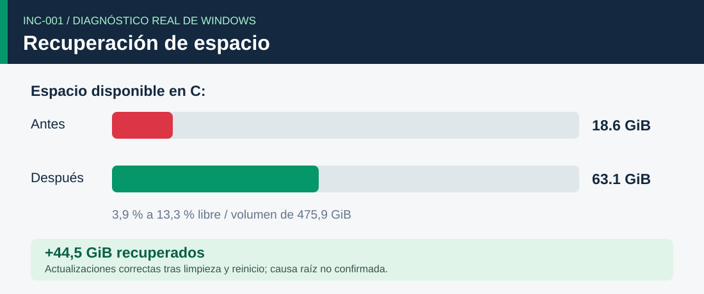

#  INC-001 · Diagnóstico de Windows Update y aplicaciones

  

[← Soporte TI](../README.md) · [Portafolio](../../README.md) · [Notas de validación](evidence/validation-notes.md)

[](evidence/validation-notes.md)

**Windows 11 · PowerShell · Visor de eventos · Microsoft Store**

El equipo presentaba fallos recurrentes de actualización de aplicaciones, incluido el error `0x80073D02`. Revisé eventos, servicios y almacenamiento antes de aplicar una limpieza de bajo impacto y reiniciar. Después, las actualizaciones finalizaron correctamente y el espacio libre aumentó de **18,6 GiB a 63,1 GiB**.

**Resultado:** incidente resuelto y validado funcionalmente. No fue posible confirmar una causa raíz única.

---

## Flujo de resolución del incidente


## 2. Descripción del problema

Se informó que Windows solicitaba actualizaciones repetidamente y que algunas no finalizaban correctamente.

No se reportaron problemas importantes de rendimiento, conectividad Wi-Fi u otras fallas generales del equipo.

**Objetivo:** identificar las posibles causas de los errores y restaurar el funcionamiento de las actualizaciones.

## 3. Entorno técnico

| Componente | Detalle |
|---|---|
| Sistema operativo | Windows 11 Pro |
| Versión | 25H2 |
| Compilación | 26200.9711 |
| Arquitectura | 64 bits |
| Almacenamiento | SSD NVMe KIOXIA de 512 GB |
| Sistema de archivos | NTFS |
| Estado del almacenamiento | Healthy |
| Herramienta de diagnóstico principal | Windows PowerShell |

## 4. Evaluación inicial

El diagnóstico comenzó con una comprobación general del sistema.

### 4.1 Información del sistema

```powershell
Get-ComputerInfo | Select-Object WindowsProductName, WindowsVersion, OsBuildNumber, OsArchitecture
```

También se consultó el Registro para comprobar la versión:

```powershell
Get-ItemProperty 'HKLM:\SOFTWARE\Microsoft\Windows NT\CurrentVersion' |
Select-Object ProductName, DisplayVersion, CurrentBuild, UBR
```

**Hallazgos:**

- Windows 11, versión 25H2.
- Compilación 26200.9711.
- Arquitectura de 64 bits.

Algunos campos informaron un nombre de producto heredado de Windows 10, pero la versión y la compilación identificaban Windows 11.

### 4.2 Evaluación del almacenamiento

```powershell
Get-Volume |
Select-Object DriveLetter, FileSystem, HealthStatus, SizeRemaining, Size
```

**Resultados iniciales:**

| Métrica | Valor inicial |
|---|---|
| Capacidad total de C: | 475,9 GiB |
| Espacio disponible | 18,6 GiB |
| Porcentaje libre | 3,9 % |
| Estado del volumen | Healthy |

El volumen del sistema tenía poco espacio disponible, lo que podía afectar las actualizaciones y el mantenimiento.

También se evaluó el estado del disco físico:

```powershell
Get-PhysicalDisk |
Select-Object FriendlyName, MediaType, HealthStatus, OperationalStatus, Size
```

El SSD NVMe informó estado **Healthy** y funcionamiento normal.

## 5. Investigación de Windows Update

### 5.1 Comprobación de servicios

```powershell
Get-Service wuauserv, bits, cryptsvc, usosvc |
Select-Object Name, Status, StartType
```

| Servicio | Estado observado | Tipo de inicio |
|---|---|---|
| BITS | Running | Automatic |
| Servicios criptográficos | Running | Automatic |
| Update Orchestrator Service | Running | Automatic |
| Windows Update | Stopped | Manual |

Aunque Windows Update estaba detenido, su configuración de inicio manual no demuestra por sí sola un problema: Windows puede iniciarlo cuando es necesario.

**No se identificó una anomalía evidente en los parámetros consultados.**

### 5.2 Revisión de actualizaciones instaladas

```powershell
Get-HotFix |
Sort-Object InstalledOn -Descending |
Select-Object -First 10 HotFixID, Description, InstalledOn
```

Se observaron actualizaciones de seguridad instaladas recientemente. Esto mostraba que algunas actualizaciones habían terminado correctamente.

### 5.3 Análisis de eventos

Se consultaron los errores recientes de Windows Update mediante:

```powershell
Get-WinEvent -FilterHashtable @{
    LogName='System'
    ProviderName='Microsoft-Windows-WindowsUpdateClient'
    Level=2
    StartTime=(Get-Date).AddDays(-14)
} -MaxEvents 15 |
Select-Object TimeCreated, Id, Message |
Format-List
```

Se identificaron **cinco fallos de actualización** con el código común `0x80073D02`.

| Aplicación | Eventos de error |
|---|---|
| Windows Web Experience Pack | 2 |
| Microsoft Office Hub | 2 |
| Microsoft Phone Link | 1 |

Este código suele asociarse a actualizaciones de paquetes de aplicaciones que no pueden terminar porque algunos recursos necesarios están en uso.

La evidencia era compatible con un posible conflicto de actualización de aplicaciones, pero no demostraba un fallo general del servicio Windows Update.

## 6. Hipótesis de diagnóstico

**Hipótesis 1 — Recursos de aplicaciones en uso:** procesos o aplicaciones en segundo plano podrían haber impedido actualizar los paquetes afectados.

**Hipótesis 2 — Espacio insuficiente:** el volumen C: tenía solamente un 3,9 % de espacio libre, lo que podía perjudicar el funcionamiento de las actualizaciones.

El espacio disponible limitado constituía un factor de riesgo, pero **no se demostró que fuera la causa directa** de `0x80073D02`.

## 7. Procedimiento de resolución

Se adoptó una estrategia conservadora, evitando modificar innecesariamente servicios y componentes críticos de Windows.

### Paso 1 — Recuperar almacenamiento

Se eliminaron archivos innecesarios para liberar espacio. No fue necesario borrar manualmente archivos críticos del sistema.

### Paso 2 — Reiniciar el equipo

Se reinició Windows para finalizar procesos activos y liberar recursos que pudieran estar bloqueando las actualizaciones.

### Paso 3 — Reintentar

Se repitieron las actualizaciones mediante Microsoft Store y se comprobaron las tareas pendientes de Windows Update.

### Paso 4 — Validar el almacenamiento

```powershell
Get-Volume -DriveLetter C |
Select-Object DriveLetter, HealthStatus, SizeRemaining, Size
```

| Métrica | Antes | Después |
|---|---|---|
| Espacio disponible | 18,6 GiB | 63,1 GiB |
| Espacio libre | 3,9 % | 13,3 % |
| Estado del volumen | Healthy | Healthy |

Se recuperaron aproximadamente **44,5 GiB**.

## 8. Resultados y validación

Después de la limpieza y del reinicio:

- Las actualizaciones de aplicaciones finalizaron correctamente.
- Windows Update dejó de presentar el problema recurrente informado.
- El espacio disponible aumentó significativamente.
- El equipo continuó funcionando normalmente.

**Estado final: Resuelto.**

La recuperación funcional se verificó con actualizaciones exitosas y desaparición del síntoma informado. Sin embargo, **no fue posible aislar una única causa raíz**. Tanto la liberación de recursos durante el reinicio como la mejora del espacio disponible pudieron contribuir al resultado.

## 9. Evidencia técnica

| Archivo | Contenido |
|---|---|
| [Información del sistema](evidence/system-information.txt) | Versión de Windows y compilación antes y después |
| [Validación de almacenamiento](evidence/storage-validation.txt) | Capacidad, espacio libre y estado del volumen |
| [Eventos de error](evidence/update-errors.txt) | Fallos históricos asociados a `0x80073D02` |
| [Notas de validación](evidence/validation-notes.md) | Recuperación funcional, hipótesis, limitaciones y conclusiones |

La evidencia está anonimizada para evitar exponer identificadores sensibles. Las salidas originales de la consola se conservan sin traducir para mantener su integridad.

## 10. Consideraciones de seguridad

- No se modificaron servicios de Windows sin necesidad.
- No se deshabilitaron controles de seguridad.
- No se eliminaron manualmente archivos críticos del sistema.
- Se utilizaron herramientas integradas de diagnóstico.
- Se priorizaron acciones de bajo riesgo y reversibles.
- Se evitó publicar información sensible.

## 11. Lecciones aprendidas

1. Revisar códigos de error y eventos antes de aplicar soluciones.
2. Correlacionar los registros técnicos con el síntoma informado.
3. No asumir que un servicio detenido implica una avería.
4. Considerar los riesgos operativos del almacenamiento insuficiente.
5. Comenzar con cambios de bajo impacto.
6. Diferenciar resolución confirmada de hipótesis sobre causa raíz.
7. Documentar tanto los resultados como sus limitaciones.

## 12. Competencias demostradas

Diagnóstico de Windows 11 · PowerShell · Visor de eventos · Windows Update · Servicios del sistema · Evaluación de almacenamiento · Investigación de causa raíz · Documentación técnica · Validación de incidentes.

## Referencias oficiales

- [Solucionador de problemas de Windows Update](https://support.microsoft.com/en-us/windows/windows-update-troubleshooter-19bc41ca-ad72-ae67-af3c-89ce169755dd)
- [Get-WinEvent](https://learn.microsoft.com/en-us/powershell/module/microsoft.powershell.diagnostics/get-winevent)
- [Get-Volume](https://learn.microsoft.com/en-us/powershell/module/storage/get-volume)
- [Get-Service](https://learn.microsoft.com/en-us/powershell/module/microsoft.powershell.management/get-service)

*Las referencias apoyan los procedimientos, pero no constituyen evidencia independiente de ejecución ni eficacia de los controles.*

---

**Estado del proyecto:** Completado  
**Identificador:** INC-001  
**Área:** Soporte TI / Diagnóstico de Windows