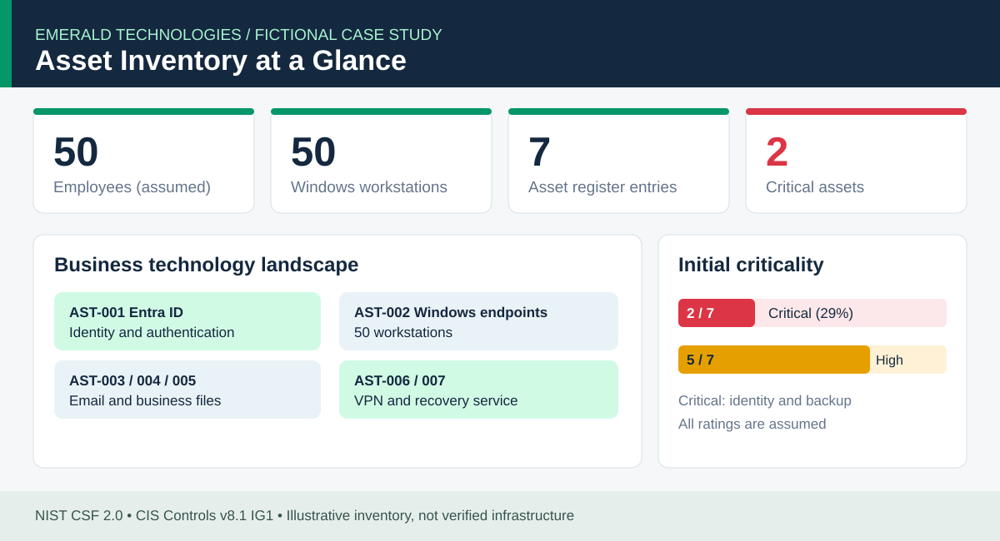
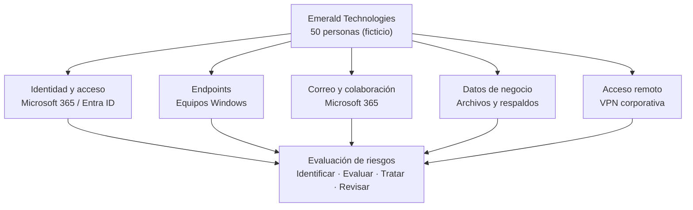
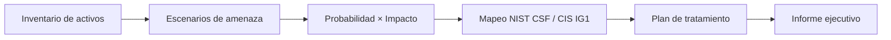
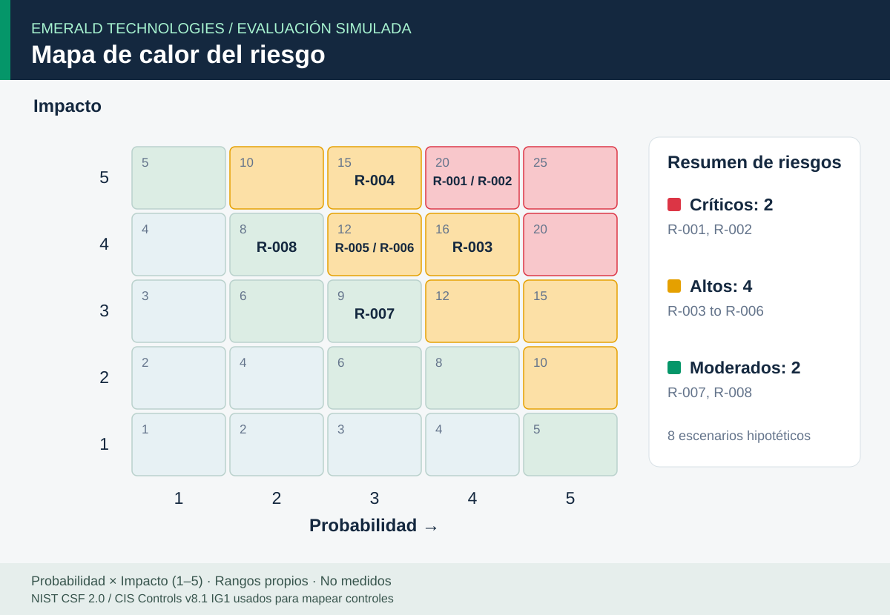
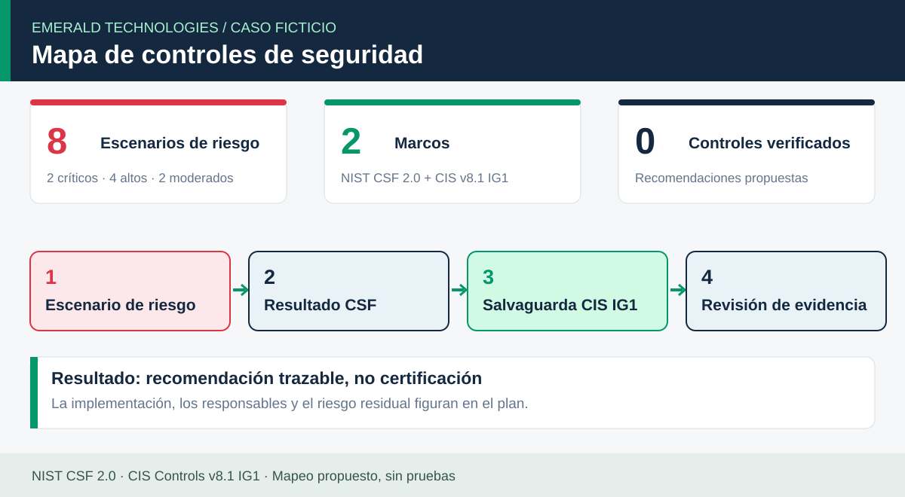
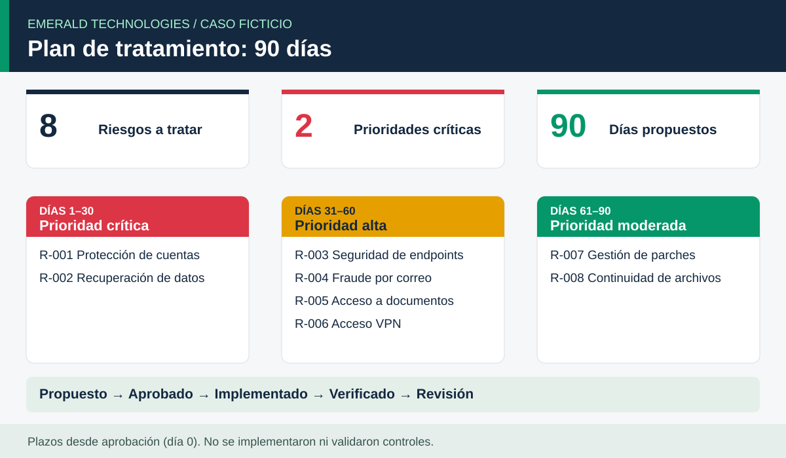
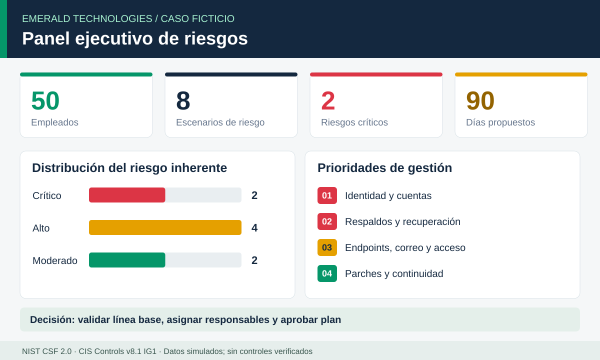

#  Evaluación de riesgos de seguridad de la información

  

[← Portafolio](../../README.md) · [Registro de riesgos](risk-register/risk-register.md) · [Mapeo de controles](controls/control-mapping.md) · [Tratamiento](treatment/risk-treatment-plan.md) · [Informe ejecutivo](reports/executive-summary.md)

**Emerald Technologies es ficticia.** Utilicé este escenario de 50 empleados para desarrollar un inventario de activos, calificar riesgos cualitativos, proponer controles y organizar un plan de tratamiento. El ejercicio aborda identidades, endpoints Windows, correo, respaldos y acceso remoto.

Es una **evaluación documental simulada**; no implica haber auditado una organización real ni comprobado controles implementados.

## Resumen de la evaluación

| Organización | Alcance | Modelo de riesgo | Entregables |
|---|---|---|---|
| **Ficticia · 50 personas** | Identidades, endpoints, correo, respaldos y VPN | **Matriz 5 × 5 definida para el ejercicio** | Registro de riesgos, controles, plan de tratamiento e informe ejecutivo |

*Los valores son ilustrativos. No se evaluaron sistemas productivos ni la eficacia de controles reales.*

## Panorama del ejercicio

| 👥 Personas | 🛡️ Áreas de seguridad | 📋 Método | 📚 Marcos |
|:---:|:---:|:---:|:---:|
| **50** | **5** | **Matriz 5 × 5** | **2** |
| Supuesto | Identidad · Endpoints · Correo · Respaldos · VPN | Evaluación definida para el proyecto | NIST CSF 2.0 · CIS v8.1 IG1 |

### Entorno tecnológico ilustrativo

### Flujo de evaluación

## Contexto y alcance

### Entorno supuesto

- Aproximadamente 50 empleados con equipos Windows.
- Microsoft 365 para correo, colaboración e identidades.
- Acceso remoto mediante VPN para determinados cargos.
- Archivos empresariales en servicios cloud o locales autorizados.
- Un pequeño equipo interno de TI para soporte y administración.

### Incluido

- Identidades y autenticación.
- Configuración, actualización y protección de endpoints.
- Amenazas de phishing y correo electrónico.
- Respaldos y recuperación de datos.
- Acceso remoto y acceso privilegiado.

### Excluido

- Pruebas de penetración física u ofensivas.
- Certificaciones formales legales o regulatorias.
- Escaneo de vulnerabilidades en producción.
- Acceso a sistemas reales de clientes.
- Modelación cuantitativa de pérdidas financieras.

## Metodología de evaluación

Se utiliza una **matriz cualitativa de 5 × 5**, definida específicamente para este proyecto. NIST CSF 2.0 organiza resultados de ciberseguridad y CIS Controls v8.1 IG1 ayuda a seleccionar salvaguardas de higiene cibernética esencial. **Ninguno de estos marcos impone la escala de puntuación usada aquí.**

1. Identificar procesos de negocio, activos de información y propietarios.
2. Describir amenazas, vulnerabilidades y consecuencias potenciales.
3. Calificar probabilidad e impacto inherentes en una escala de 1 a 5.
4. Calcular el puntaje de riesgo inicial: **Probabilidad × Impacto**.
5. Identificar controles existentes **supuestos** y brechas.
6. Asociar medidas propuestas con resultados NIST CSF 2.0 y salvaguardas CIS IG1 pertinentes.
7. Recomendar tratamiento, responsables, plazos y evidencia de validación.
8. Reevaluar riesgo residual solamente con controles y supuestos documentados de manera suficiente.

### Escala de riesgo

| Puntaje | Categoría | Interpretación |
|---|---|---|
| 1–4 | Bajo | Gestionar mediante controles habituales |
| 5–9 | Moderado | Planificar mejoras proporcionales |
| 10–16 | Alto | Priorizar tratamiento y revisión de dirección |
| 17–25 | Crítico | Requiere atención temprana y planificación del tratamiento |

**Probabilidad:** 1 = Rara; 2 = Poco probable; 3 = Posible; 4 = Probable; 5 = Casi segura.  
**Impacto:** 1 = Insignificante; 2 = Menor; 3 = Moderado; 4 = Mayor; 5 = Severo.

Los puntajes son **ilustrativos**, no probabilidades medidas ni pérdidas financieras calculadas. Aceptar un riesgo requiere una decisión autorizada de negocio.

## Uso de marcos

### NIST CSF 2.0

Las seis funciones —**Govern, Identify, Protect, Detect, Respond y Recover**— ofrecen una estructura para organizar resultados y comunicar prioridades. El mapeo de controles documenta categorías y subcategorías pertinentes.

### CIS Controls v8.1 — Implementation Group 1 (IG1)

IG1 proporciona una línea base priorizada de salvaguardas esenciales. Se identifican medidas aplicables sin afirmar que IG1 garantice seguridad o cumplimiento por sí mismo.

## Vista previa de riesgos

*Ocho escenarios ficticios: dos críticos, cuatro altos y dos moderados. Los valores son supuestos, no hallazgos medidos.*

## Mapeo de controles

*Solo salvaguardas propuestas; no se verificó su implementación ni eficacia.*

## Plan de tratamiento

*Secuencia propuesta. No se implementaron ni validaron controles.*

## Distribución de riesgos

*25 % críticos, 50 % altos y 25 % moderados dentro de la muestra ilustrativa de ocho escenarios.*

## Panel ejecutivo

*Resumen para la dirección, basado en ocho escenarios y una propuesta de tratamiento de 90 días.*

## Entregables

| Documento | Propósito | Estado |
|---|---|---|
| [Inventario de activos](assets/asset-inventory.md) | Identificar activos, valor y propiedad | Completado · Simulado |
| [Registro de riesgos](risk-register/risk-register.md) | Documentar escenarios y puntajes inherentes | Completado · Simulado |
| [Mapeo de controles](controls/control-mapping.md) | Asociar tratamiento con NIST CSF y CIS IG1 | Completado · Propuesto |
| [Plan de tratamiento](treatment/risk-treatment-plan.md) | Asignar medidas, responsables y criterios de validación | Completado · Propuesto |
| [Resumen ejecutivo](reports/executive-summary.md) | Comunicar prioridades a la dirección | Completado · Simulado |

## Competencias demostradas

Evaluación de riesgos de información · Análisis de impacto y probabilidad · Inventario de activos · NIST CSF 2.0 · CIS Controls IG1 · Priorización de tratamiento · Informes ejecutivos · Documentación técnica.

## Referencias oficiales

- [NIST Cybersecurity Framework 2.0](https://www.nist.gov/cyberframework)
- [CIS Controls v8.1 Navigator](https://www.cisecurity.org/controls/cis-controls-navigator)
- [NIST SP 800-30 Rev. 1 — Evaluación de riesgos](https://csrc.nist.gov/pubs/sp/800/30/r1/final)

*Estas referencias apoyan el marco metodológico y no prueban ejecución de controles.*

---

**Caso ficticio para aprendizaje y portafolio.** No se declara una evaluación organizacional real, controles implementados ni cumplimiento verificado.