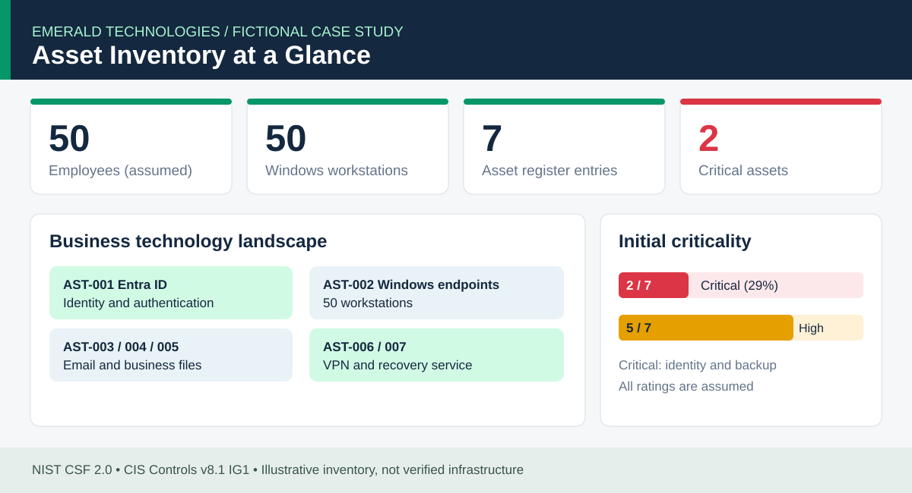
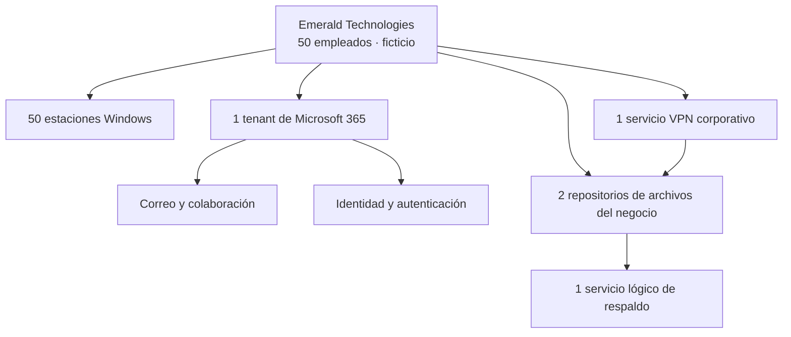

# Inventario de activos — Emerald Technologies

**Proyecto:** Evaluación de riesgos de seguridad de la información empresarial  
**Organización:** Emerald Technologies (**ficticia**)  
**Marcos de referencia:** NIST CSF 2.0 / CIS Controls v8.1 IG1  
**Estado:** Línea base simulada; no contrastada con un entorno real

## 1. Objetivo y supuestos

Este inventario define una **línea base ficticia para planificación**, destinada a identificar activos, dependencias del negocio, responsables y prioridades de seguridad. Es un inventario por escenarios, **no una CMDB verificada dispositivo por dispositivo** ni el resultado de un escaneo.

### Perfil supuesto de la organización

| Métrica | Valor supuesto | Observaciones |
|---|---:|---|
| Empleados | **50** | Dotación ficticia |
| Estaciones de trabajo Windows | **50** | Un equipo administrado por empleado (supuesto) |
| Tenant de Microsoft 365 | **1** | Identidad, correo y colaboración |
| Servicio VPN corporativo | **1** | Personal remoto autorizado, sin cantidad especificada |
| Repositorios de archivos del negocio | **2** | Uno de colaboración cloud y otro de archivos compartidos internos |
| Servicio de respaldo | **1** | Servicio lógico; cobertura y recuperación desconocidas |
| Dominios de activos evaluados | **5** | Identidades, endpoints, correo, datos/respaldos y acceso remoto |

**Criterio de conteo:** estas métricas describen tipos de activos diferentes, por lo que no deben sumarse como si todos fueran dispositivos físicos. Microsoft 365 sirve a más de un dominio y los respaldos constituyen una dependencia lógica.

## 2. Panorama visual de activos

*La arquitectura es ilustrativa. Las conexiones representan dependencias conceptuales de negocio, no una topología real ni cobertura de respaldo validada.*

## 3. Registro de activos

**Criticidad propuesta:** Crítica = una falla podría interrumpir gravemente servicios esenciales o de seguridad; Alta = interrupción operacional importante; Media = interrupción limitada o recuperable. Son **supuestos preliminares del analista**, sin aprobación de partes interesadas.

| ID | Activo / Servicio | Tipo | Cantidad | Propietario del negocio (rol) | Custodio técnico (rol) | Criticidad | Riesgo principal |
|---|---|---|---|---|---|---|---|
| AST-001 | Identidades de Microsoft Entra ID | Identidad | 1 tenant / hasta 50 identidades | Gerente de Operaciones | Administrador TI | **Crítica** | Compromiso de cuentas o recuperación MFA débil |
| AST-002 | Equipos Windows de empleados | Endpoints | 50 dispositivos | Jefaturas de área | Soporte TI | Alta | Malware, parches pendientes, pérdida de equipos |
| AST-003 | Correo y colaboración Microsoft 365 | SaaS | 1 tenant | Gerente de Operaciones | Administrador M365 | Alta | Phishing, compromiso de buzones, uso compartido de datos |
| AST-004 | Repositorio cloud de colaboración | Información | 1 repositorio lógico | Jefaturas de área | Administrador M365 | Alta | Acceso no autorizado, eliminación accidental |
| AST-005 | Archivos compartidos internos | Información | 1 repositorio lógico | Gerente de Operaciones | Administrador de Infraestructura | Alta | Permisos excesivos, interrupción |
| AST-006 | VPN corporativa | Acceso remoto | 1 servicio | Gerente de Operaciones | Administrador de Redes | Alta | Acceso remoto no autorizado, errores de configuración |
| AST-007 | Servicio de respaldo y recuperación | Recuperación | 1 servicio lógico | Gerente de Operaciones | Administrador de Infraestructura | **Crítica** | Restauraciones fallidas, cobertura incompleta |

**Responsabilidades:** el propietario del negocio responde por los requisitos y decisiones de riesgo; el custodio técnico mantiene el servicio e implementa los controles aprobados. Los roles son ficticios y requieren validación si se utiliza el método en una organización real.

## 4. Clasificación de información

| Información | Ejemplo | Clasificación propuesta | Objetivo principal |
|---|---|---|---|
| Identidad y RR. HH. | Cuentas y documentos de personal | Confidencial | Confidencialidad e integridad |
| Correspondencia del negocio | Correos de clientes y proveedores | Interna / Confidencial, según contenido | Confidencialidad y disponibilidad |
| Documentos operacionales | Procedimientos, contratos y proyectos | Interna / Confidencial, según contenido | Integridad y disponibilidad |
| Material de marketing público | Información ya publicada | Pública | Integridad |
| Copias de respaldo | Copias protegidas de información | Igual que la información de origen | Confidencialidad, integridad y recuperabilidad |

**Nota:** son categorías propuestas de manejo para el caso ficticio, no clasificación legal ni sustituto de una política de información formalmente aprobada.

## 5. Dependencias del negocio

| Capacidad | Activos involucrados | Posible consecuencia |
|---|---|---|
| Inicio de sesión y acceso | AST-001, AST-002 | Incapacidad para autenticarse o acceder a servicios |
| Comunicación corporativa | AST-001, AST-003 | Interrupción de correo y colaboración |
| Acceso a documentos | AST-001, AST-004, AST-005, AST-006 en acceso remoto | Usuarios sin acceso a archivos necesarios |
| Operación remota | AST-001, AST-002, AST-006 | Personal remoto sin acceso a servicios internos |
| Recuperación de datos | AST-004, AST-005, AST-007 | Recuperación tardía o fallida |

## 6. Preguntas iniciales de seguridad

Las siguientes son **preguntas de evaluación**, no deficiencias confirmadas:

- ¿Todas las cuentas están protegidas por métodos MFA aprobados?
- ¿Existe un inventario actualizado y conciliado de los 50 equipos supuestos?
- ¿Se monitorean actualizaciones y controles de seguridad?
- ¿Se revisan los permisos de archivos compartidos bajo necesidad de negocio?
- ¿Los respaldos se protegen, monitorean y prueban mediante restauraciones?
- ¿La VPN se limita a usuarios autorizados y dispositivos administrados?
- ¿Se separan las cuentas privilegiadas de las cuentas de uso diario?

## 7. Relación con NIST CSF y CIS IG1

El inventario apoya actividades de **IDENTIFY** en NIST CSF 2.0, incluida la gestión de activos. También permite evaluar salvaguardas CIS Controls v8.1 IG1 relacionadas con inventario de activos y software, cuentas, acceso, protección de datos y recuperación.

Las correspondencias específicas se documentan en [mapeo de controles](../controls/control-mapping.md). La alineación es propuesta, no auditada independientemente.

## 8. Evidencia y limitaciones

**Observaciones verificadas:** ninguna; escenario ficticio.  
**Integridad del inventario:** no verificable sin descubrimiento autorizado.  
**Confirmación de propietarios:** no realizada.  
**Aprobación de criticidad:** no realizada.  
**Paso siguiente:** desarrollar un registro de riesgos con escenarios, probabilidad, impacto y supuestos de tratamiento.

## Referencias oficiales

- [NIST CSF 2.0 — Identificación y gestión de activos](https://www.nist.gov/cyberframework)
- [CIS Controls v8.1 Navigator](https://www.cisecurity.org/controls/cis-controls-navigator)

*Las referencias sustentan los métodos y no validan resultados de una organización real.*

---

*Caso para portafolio: todas las cifras y los registros de activos son supuestos ficticios.*