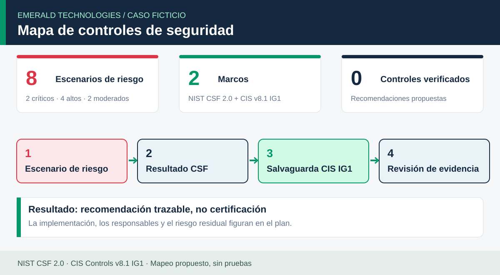
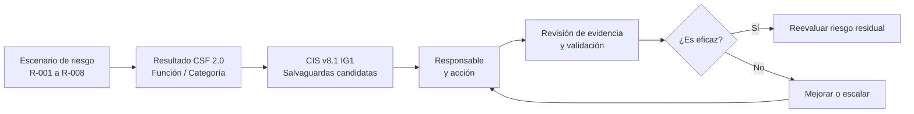

# Mapeo de controles de seguridad — Emerald Technologies

**Caso de estudio:** Emerald Technologies, organización ficticia de 50 personas  
**Alcance:** Ocho riesgos inherentes hipotéticos (R-001 a R-008)  
**Referencias:** NIST CSF 2.0 y CIS Controls v8.1, Implementation Group 1 (IG1)  
**Estado:** Controles solo propuestos; no implementados, probados ni auditados

> **Importante:** ejercicio de portafolio. Las asociaciones entre escenarios, resultados CSF y salvaguardas CIS fueron seleccionadas por el analista. **No constituyen una correspondencia oficial NIST/CIS, acreditación de cumplimiento ni prueba de eficacia.** Verificar textos vigentes y aplicabilidad antes de utilizarlas en producción.

## 1. Cómo interpretar el mapeo

- **ID de riesgo:** escenario del [registro de riesgos](../risk-register/risk-register.md).
- **NIST CSF 2.0:** funciones y categorías que expresan resultados de seguridad esperados.
- **CIS v8.1 IG1:** salvaguardas candidatas para alcanzarlos.
- **Evidencia de validación:** documentación o pruebas que un evaluador autorizado debería solicitar.
- **Estado:** todos los controles están **Propuestos / No verificados**.

NIST CSF organiza resultados y CIS Controls propone medidas concretas. Se complementan: CSF no se interpreta como checklist prescriptivo ni IG1 como garantía de seguridad.

## 2. Matriz de riesgo y controles

| Riesgo | Escenario | Categoría NIST CSF 2.0 | Salvaguardas CIS v8.1 candidatas | Objetivo del control | Estado |
|---|---|---|---|---|---|
| **R-001** | Apropiación de cuentas | **PR.AA** — Gestión de identidades, autenticación y acceso; **DE.CM** — Monitoreo continuo | **5.1** Inventario de cuentas; **6.3** MFA en aplicaciones expuestas; **6.5** MFA en accesos administrativos | Inventariar cuentas, proteger accesos y detectar anomalías | Propuesto |
| **R-002** | Datos irrecuperables tras ransomware | **PR.DS** — Seguridad de datos; **RC.RP** — Ejecución de recuperación | **11.1** Proceso de recuperación; **11.2** Respaldos automáticos; **11.5** Pruebas de recuperación (medida adicional IG2/IG3) | Copias recuperables y probadas | Propuesto |
| **R-003** | Ransomware en endpoints | **PR.PS** — Seguridad de plataformas; **DE.CM** — Monitoreo continuo | **4.1** Proceso de configuración segura; **7.3** Parches automáticos del sistema operativo; **10.1** Protección antimalware | Reducir superficie de ataque y ejecución maliciosa | Propuesto |
| **R-004** | Compromiso del correo empresarial | **PR.AT** — Concientización y capacitación; **PR.AA** — Identidad y acceso | **14.2** Capacitación contra ingeniería social; **6.3** MFA en aplicaciones expuestas | Reducir phishing y accesos a buzones no autorizados | Propuesto |
| **R-005** | Acceso indebido a documentos cloud | **PR.AA** — Identidad y acceso; **PR.DS** — Seguridad de datos | **3.3** ACL de datos; **6.1** Proceso de concesión de acceso; **6.2** Revocación de acceso | Mínimo privilegio y compartición controlada | Propuesto |
| **R-006** | Acceso VPN no autorizado | **PR.AA** — Identidad y acceso | **6.4** MFA para acceso remoto a redes; **5.1** Inventario de cuentas | Autenticar usuarios remotos y administrar autorizaciones | Propuesto |
| **R-007** | Explotación de equipos sin parches | **PR.PS** — Seguridad de plataformas | **7.3** Parches automáticos del SO; **7.4** Parches automáticos de aplicaciones | Mantener actualizaciones oportunas | Propuesto |
| **R-008** | Caída de archivos compartidos | **PR.IR** — Resiliencia de infraestructura; **RC.RP** — Ejecución de recuperación | **11.1** Proceso de recuperación; **11.5** Pruebas de recuperación (IG2/IG3) | Mejorar recuperación de servicios | Propuesto |

**Granularidad:** se utilizan códigos de **categoría** CSF, no se afirma cumplimiento de todas las subcategorías. Confirmar aplicabilidad y pertenencia a grupos de implementación usando el texto oficial CIS v8.1.

## 3. Flujo de tratamiento

## 4. Evidencia de validación propuesta

| Riesgo | Responsable técnico propuesto | Evidencia a solicitar | Criterio ilustrativo |
|---|---|---|---|
| R-001 | Administrador TI | Inventario de cuentas, política MFA y proceso de revisión | Cuentas activas conciliadas, MFA verificado en muestra |
| R-002 | Administrador de Infraestructura | Política de respaldo, reportes de trabajos, copias protegidas y prueba de restauración | Restauración autorizada dentro de objetivos acordados |
| R-003 | Soporte TI / Seguridad | Política de endpoints, antimalware y reporte de parches | Equipos muestreados cumplen línea base aprobada |
| R-004 | Administrador M365 / RR. HH. | Registro de capacitaciones, MFA y proceso de reporte | Personal seleccionado capacitado, protección de acceso a buzón comprobada |
| R-005 | Administrador M365 / Propietario de datos | Políticas de compartición, revisiones, tickets de altas/bajas | Permisos coherentes con aprobaciones |
| R-006 | Administrador de Redes | Política VPN, autorizaciones y MFA | Cuentas muestreadas cumplen requisitos de acceso remoto |
| R-007 | Soporte TI | Informes de actualización y excepciones | Excepciones controladas y plazos de parcheo cumplidos |
| R-008 | Administrador de Infraestructura | Procedimientos, dependencias y restauraciones | Ejercicio documentado dentro de objetivos de recuperación |

**Estas son pruebas propuestas, no resultados reales.** Umbrales, muestras y objetivos deben acordarse con responsables técnicos y de negocio.

## 5. Priorización

**Primera prioridad:** riesgos críticos R-001 y R-002.  
**Segunda prioridad:** riesgos altos R-003 a R-006.  
**Tercera prioridad:** riesgos moderados R-007 y R-008.

Las prioridades derivan de puntajes inherentes supuestos y podrían cambiar tras evaluar controles, impacto y dependencias.

## 6. Afirmaciones fuera del alcance

- No se revisaron configuraciones reales de Microsoft 365, Windows, VPN o respaldos.
- No se desplegaron ni probaron controles.
- No se calculó riesgo residual.
- No se verificó cumplimiento legal o de un marco.
- No se reprodujo una matriz oficial de correspondencia NIST/CIS.

## 7. Entregable siguiente

El [plan de tratamiento](../treatment/risk-treatment-plan.md) define responsables, medidas, prioridades, plazos y criterios de aceptación. Mantiene estado **propuesto** hasta que exista evidencia de implementación y eficacia.

**Aclaración importante:** la salvaguarda CIS **11.5 — Test Data Recovery** corresponde a **IG2/IG3**, no a IG1. La prueba de restauración se propone como medida **adicional a IG1**. Las salvaguardas CIS 11.1–11.4 sí pertenecen a IG1.

## Referencias

- [NIST Cybersecurity Framework 2.0](https://www.nist.gov/cyberframework)
- [CIS Controls v8.1 Navigator](https://www.cisecurity.org/controls/cis-controls-navigator)

*Referencias de selección de controles, no pruebas de cumplimiento o implementación.*

---

*Caso ficticio con fines educativos y de portafolio profesional.*