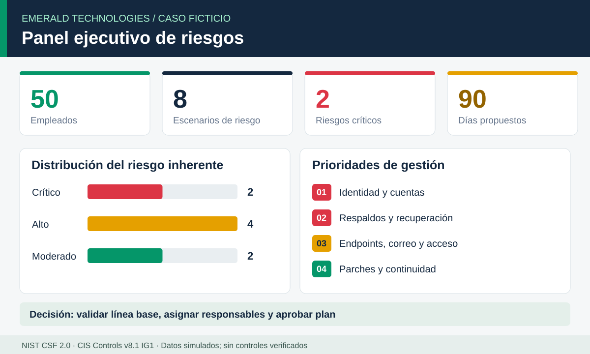
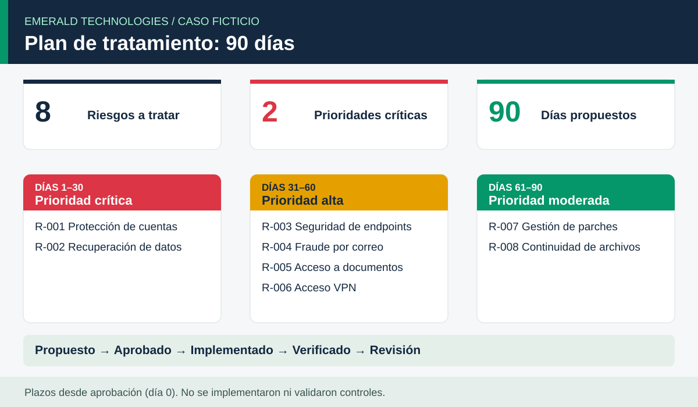

# Resumen ejecutivo — Evaluación de riesgos de seguridad de la información

**Dirigido a:** Gerencia ejecutiva de Emerald Technologies (**ficticia**)  
**Evaluación:** Seguridad de la información empresarial  
**Marcos:** NIST CSF 2.0 · CIS Controls v8.1 IG1  
**Tipo:** Caso hipotético cualitativo  
**Estado:** Documentación completada; recomendaciones **no implementadas ni validadas**

> **Advertencia:** la empresa, sus 50 empleados, inventario y puntajes son ficticios. El documento ilustra comunicación ejecutiva de riesgos, no hallazgos verificados de una organización real.

## 1. Decisión ejecutiva solicitada

**Decisión hipotética:** autorizar la planificación de una reducción de riesgos a 90 días, asignar responsables técnicos y de negocio, verificar inventario y controles, y aprobar presupuesto proporcional **después** de definir alcance y costos.

El escenario considera **50 empleados**, **50 estaciones Windows**, Microsoft 365, VPN, repositorios de archivos y servicios de respaldo/recuperación.

Se evaluaron ocho riesgos inherentes hipotéticos usando una **matriz 5 × 5** de probabilidad por impacto, definida por el proyecto.

| Categoría | Cantidad | Proporción | Implicancia para la dirección |
|---|---:|---:|---|
| **Crítico** | **2** | **25 %** | Priorizar identidades y recuperación de datos |
| **Alto** | **4** | **50 %** | Mejorar endpoints, correo, acceso a archivos y VPN |
| **Moderado** | **2** | **25 %** | Abordar parches y continuidad del servicio de archivos |
| **Bajo** | **0** | **0 %** | Ningún escenario seleccionado resultó Bajo |

Estas proporciones corresponden **solo a ocho escenarios ficticios**, no a la exposición real de la empresa, probabilidad de incidentes o nivel de cumplimiento.

## 2. Riesgos principales del negocio

### Prioridad 1 — Apropiación de cuentas (R-001)

**Puntaje inherente:** 20/25 — Crítico.  
**Impacto potencial:** cuentas de empleados o administradores comprometidas podrían exponer información, interrumpir la colaboración y facilitar otras acciones no autorizadas.  
**Respuesta propuesta:** verificar inventario de cuentas, cobertura MFA, privilegios y monitoreo de autenticaciones.  
**Decisión requerida:** nombrar responsables y autorizar revisión de controles IAM.

### Prioridad 2 — Datos empresariales irrecuperables (R-002)

**Puntaje inherente:** 20/25 — Crítico.  
**Impacto potencial:** ransomware o fallas operativas podrían interrumpir procesos por períodos prolongados si los respaldos no permiten restaurar.  
**Respuesta propuesta:** evaluar cobertura de respaldo, copias protegidas, procedimientos y objetivos de recuperación mediante pruebas autorizadas.  
**Decisión requerida:** identificar datos críticos y aprobar metas de recuperación.

### Prioridad 3 — Riesgos operativos y de acceso (R-003 a R-006)

**Puntajes inherentes:** 12–16/25 — Alto.  
**Impacto potencial:** malware, correo fraudulento, permisos inapropiados y VPN no autorizada podrían afectar servicios y datos.  
**Respuesta propuesta:** fortalecer línea base de endpoints, procedimientos contra phishing, revisiones de acceso y política de VPN.

### Prioridad 4 — Continuidad operativa (R-007 y R-008)

**Puntajes inherentes:** 8–9/25 — Moderado.  
**Impacto potencial:** falta de parches y fallas de archivos internos podrían disminuir disponibilidad y aumentar esfuerzos de recuperación.  
**Respuesta propuesta:** monitoreo de parches y pruebas documentadas de recuperación.

## 3. Hoja de ruta de 90 días

| Fase | Período | Riesgos | Decisión o evidencia esperada |
|---|---|---|---|
| **1** | Días 1–30 | Críticos: R-001, R-002 | Validar identidades y respaldos, revisar MFA y ejecutar prueba autorizada de restauración |
| **2** | Días 31–60 | Altos: R-003 a R-006 | Evaluar endpoints, correo, permisos y accesos VPN |
| **3** | Días 61–90 | Moderados: R-007, R-008 | Comprobar gestión de parches y recuperación de archivos |

**Día 0:** fecha futura de aprobación hipotética de gerencia. Los plazos son **propuestos**, no actividades completadas ni promesas de implementación. La secuencia depende de recursos y resultados reales.

## 4. Gobierno y marcos

**NIST CSF 2.0** proporciona una estructura de resultados mediante **Govern, Identify, Protect, Detect, Respond y Recover**.

**CIS Controls v8.1 IG1** ofrece salvaguardas candidatas de base. El [mapeo de controles](../controls/control-mapping.md) relaciona riesgos con medidas y evidencias propuestas.

Este ejercicio **no declara certificación NIST, cumplimiento CIS ni uso de una correspondencia oficial**.

### Responsabilidades propuestas

| Rol | Responsabilidad |
|---|---|
| Patrocinador ejecutivo — Gerente de Operaciones | Aprobar alcance, recursos y decisiones de tratamiento |
| Propietarios de riesgos | Confirmar impacto, exposición aceptable y decisiones residuales |
| Responsables de TI / Infraestructura / Redes / M365 | Ejecutar cambios autorizados y producir evidencia |
| Soporte TI / Revisores de Seguridad | Seguir excepciones, validar criterios y escalar brechas |

## 5. Acciones recomendadas a dirección

1. **Aprobar descubrimiento y validación:** confirmar supuestos de la línea base antes de usar puntajes reales.
2. **Asignar responsables:** identificar para cada riesgo un dueño de negocio y responsable técnico.
3. **Priorizar exposiciones críticas:** revisar identidades y capacidad de recuperación.
4. **Definir hitos basados en evidencia:** políticas, revisiones, informes de parches y restauraciones.
5. **Aprobar objetivos de recuperación:** establecer RTO y RPO para información y servicios críticos.
6. **Solicitar estimación de implementación:** evaluar licencias, personas, esfuerzo y dependencias.
7. **Revisar riesgo residual:** solo cuando estén implementados y probados los controles.

## 6. Indicadores propuestos de éxito

| KPI | Cálculo propuesto | Línea base actual |
|---|---|---|
| Cobertura MFA de cuentas aplicables | Cuentas conformes verificadas / cuentas incluidas | No medida |
| Cumplimiento de parches | Equipos dentro del SLA de actualización / equipos incluidos | No medida |
| Restauraciones exitosas | Pruebas aprobadas exitosas / pruebas realizadas | No medida |
| Revisiones de acceso completadas | Revisiones aprobadas realizadas / revisiones programadas | No medida |
| Verificación del tratamiento | Acciones con evidencia aceptada / acciones aprobadas | 0 verificadas en la simulación |

**No se informan KPI reales.** Los objetivos deben definirse una vez validados el entorno y sus restricciones.

## 7. Limitaciones y próxima decisión

Evaluación **ficticia realizada a nivel documental**. No incluye entrevistas, inventario descubierto, inspección de configuraciones, escaneo de vulnerabilidades, pérdidas financieras reales ni validación operativa. La matriz 5 × 5 es específica del ejercicio y no obligatoria según NIST/CIS.

**Decisión recomendada:** aprobar una fase de validación de línea base y planificación de tratamientos críticos. No cerrar riesgos ni asignar puntajes residuales sin evidencia y revisión del propietario.

## Documentos de respaldo

- [Inventario de activos](../assets/asset-inventory.md)
- [Registro y mapa de calor](../risk-register/risk-register.md)
- [Mapeo NIST CSF / CIS IG1](../controls/control-mapping.md)
- [Plan de tratamiento](../treatment/risk-treatment-plan.md)
- [NIST CSF](https://www.nist.gov/cyberframework)
- [CIS Critical Security Controls](https://www.cisecurity.org/controls)

## Referencias oficiales

- [NIST Cybersecurity Framework 2.0](https://www.nist.gov/cyberframework)
- [CIS Controls v8.1 Navigator](https://www.cisecurity.org/controls/cis-controls-navigator)
- [NIST SP 800-30 Rev. 1](https://csrc.nist.gov/pubs/sp/800/30/r1/final)

*Los marcos respaldan las metodologías; los puntajes ficticios no son hallazgos verificados.*

---

*Documento ejecutivo preparado para un caso de estudio educativo y ficticio.*