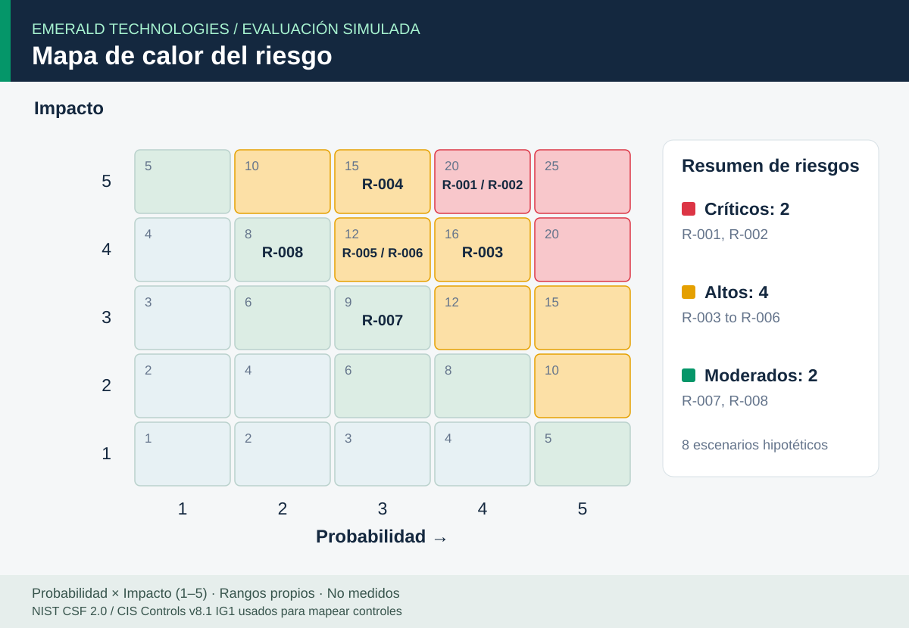
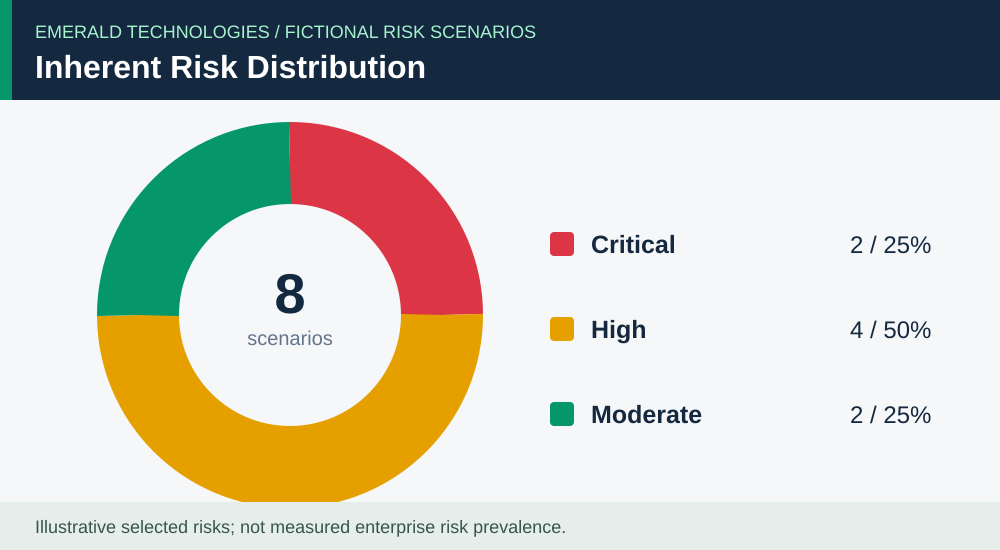
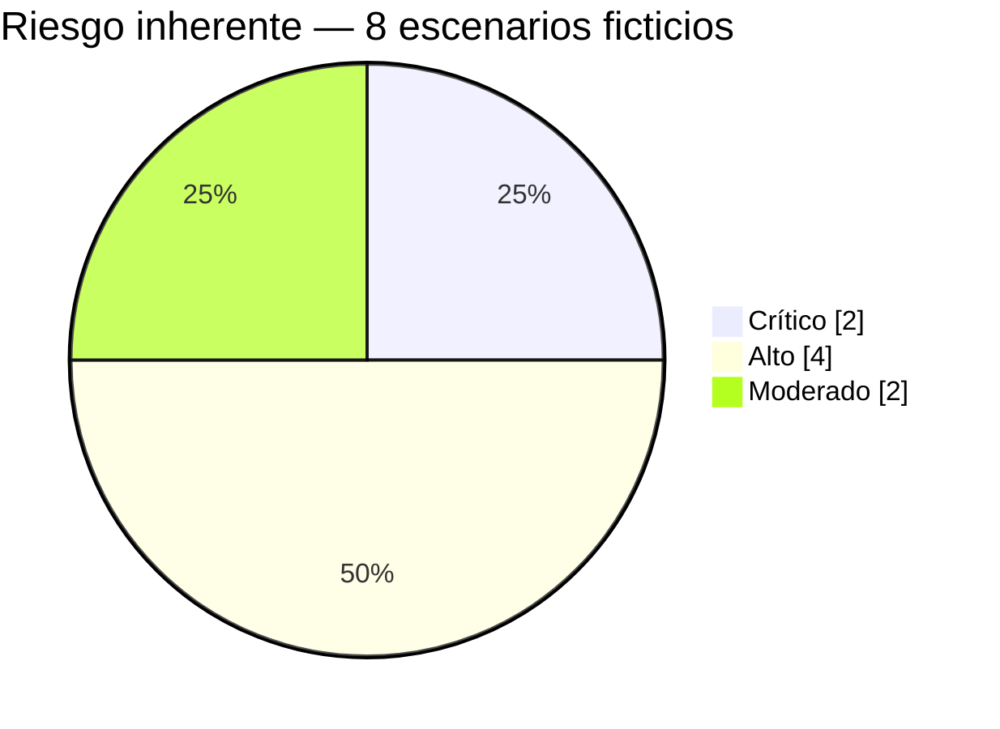

# Registro de riesgos — Emerald Technologies

**Evaluación:** Riesgos de seguridad de la información empresarial (**ficticia**)  
**Método:** Matriz cualitativa de probabilidad × impacto de 5 × 5 definida por el proyecto  
**Estado:** Análisis simulado, sin pruebas técnicas ni validación de partes interesadas

## Resumen

| Total | Críticos | Altos | Moderados | Bajos |
|---:|---:|---:|---:|---:|
| **8** | **2** | **4** | **2** | **0** |

> **Interpretación:** las puntuaciones son estimaciones **ilustrativas de riesgo inherente** basadas en escenarios hipotéticos, antes de evaluar la eficacia de controles. No prueban vulnerabilidades, frecuencia real de incidentes ni exposición de una empresa existente.

## 1. Método de puntuación

**Puntaje = Probabilidad (1–5) × Impacto (1–5).**

- Probabilidad: 1 Rara · 2 Poco probable · 3 Posible · 4 Probable · 5 Casi segura.
- Impacto: 1 Insignificante · 2 Menor · 3 Moderado · 4 Mayor · 5 Severo.
- Bajo: **1–4**; Moderado: **5–9**; Alto: **10–16**; Crítico: **17–25**.

Esta escala es **propia del ejercicio**. NIST CSF 2.0 y CIS Controls v8.1 IG1 se utilizan para estructurar resultados y recomendaciones, **no** como fuente de la fórmula de puntuación.

## 2. Registro de riesgos

| ID | Escenario | Activos afectados | P | I | Puntaje | Categoría | Responsable de negocio propuesto |
|---|---|---|---:|---:|---:|---|---|
| **R-001** | Apropiación de cuentas por credenciales comprometidas | AST-001, AST-003 | 4 | 5 | **20** | **Crítico** | Gerente de Operaciones |
| **R-002** | Pérdida irrecuperable de información tras ransomware | AST-005, AST-007 | 4 | 5 | **20** | **Crítico** | Gerente de Operaciones |
| **R-003** | Ransomware en endpoints de empleados | AST-002, AST-005 | 4 | 4 | **16** | Alto | Jefaturas de área |
| **R-004** | Compromiso de correo empresarial y fraude de pagos | AST-003 | 3 | 5 | **15** | Alto | Gerente de Operaciones |
| **R-005** | Acceso no autorizado a documentos cloud | AST-001, AST-004 | 3 | 4 | **12** | Alto | Jefaturas de área |
| **R-006** | Acceso remoto no autorizado mediante VPN | AST-001, AST-006 | 3 | 4 | **12** | Alto | Gerente de Operaciones |
| **R-007** | Explotación de equipo sin parches | AST-002 | 3 | 3 | **9** | Moderado | Jefaturas de área |
| **R-008** | Indisponibilidad de carpeta compartida interna | AST-005 | 2 | 4 | **8** | Moderado | Gerente de Operaciones |

**P = Probabilidad; I = Impacto.** Los activos se identifican en el [inventario](../assets/asset-inventory.md). Los responsables son roles ficticios.

## 3. Justificación y tratamiento preliminar

| Riesgo | Justificación ilustrativa | Tratamiento inicial propuesto |
|---|---|---|
| R-001 | Phishing o reutilización de credenciales podrían permitir acceso no autorizado; eficacia de MFA no verificada | Revisar MFA, accesos privilegiados y recuperación de cuentas; monitorear inicios de sesión |
| R-002 | Malware podría cifrar datos compartidos mientras respaldos insuficientes o no probados retrasan restauración | Validar cobertura, protección, pruebas de restauración y objetivos de recuperación |
| R-003 | Ejecución maliciosa y cobertura desconocida de parches y seguridad podrían interrumpir operación | Reforzar configuración, protección, actualización y recuperación de endpoints |
| R-004 | Buzón suplantado o comprometido podría originar instrucciones fraudulentas o divulgación | Mejorar concientización, procedimientos de verificación y protección de cuentas |
| R-005 | Permisos amplios o cuentas comprometidas podrían revelar documentos sensibles | Revisar compartición, gestión de acceso y clasificación de datos |
| R-006 | Política de acceso remoto débil o credenciales comprometidas podrían exponer servicios internos | Revisar política VPN, MFA, estado del dispositivo y registros del gateway |
| R-007 | Ausencia de evidencia de cumplimiento de parches podría dejar vulnerabilidades explotables | Establecer procedimiento supervisado de parches y mitigación |
| R-008 | Falla de infraestructura o configuración podría interrumpir acceso a archivos | Revisar dependencias, recuperación y control de cambios |

Son **mejoras propuestas**, no afirmaciones de que falten controles o sean ineficaces.

## 4. Mapa de calor

El gráfico muestra cada riesgo con probabilidad en el eje horizontal e impacto en el vertical. Si dos riesgos comparten celda, aparecen ambos identificadores. Los colores representan las bandas **definidas para este proyecto**.

### Distribución

## 5. Limitaciones

- No se entrevistaron responsables ni se recopilaron escaneos, pruebas de controles, incidentes reales o pérdidas efectivas.
- Probabilidad e impacto son supuestos de criterio profesional aplicados a una empresa ficticia.
- **No se calculó riesgo residual**, porque no se evaluó existencia ni eficacia de controles.
- Aceptación, tolerancia y tratamiento requieren responsables de negocio autorizados.
- Las prioridades podrían cambiar tras validar activos, probar controles y analizar impacto de negocio.

## 6. Paso siguiente

Vincular cada riesgo con resultados **NIST CSF 2.0** y salvaguardas **CIS Controls v8.1 IG1**, y proponer un plan con responsables y criterios verificables.

## Referencias oficiales

- [NIST SP 800-30 Rev. 1 — Guía para evaluación de riesgos](https://csrc.nist.gov/pubs/sp/800/30/r1/final)
- [NIST Cybersecurity Framework 2.0](https://www.nist.gov/cyberframework)

*Las referencias respaldan la metodología, no prueban ejecución ni eficacia en este caso.*

---

*Caso de estudio ficticio; no se evaluó ninguna organización real.*