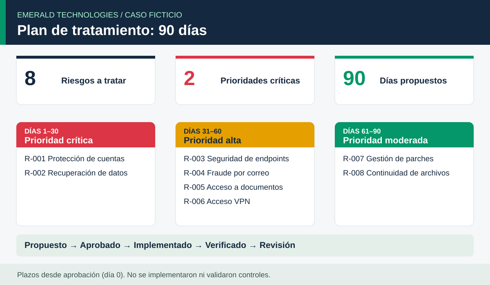
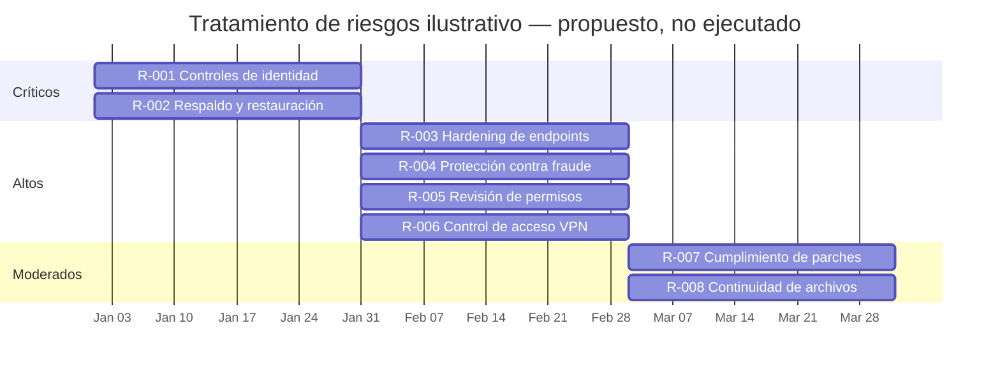

# Plan de tratamiento de riesgos — Emerald Technologies

**Organización:** Emerald Technologies (**ficticia**)  
**Marcos de referencia:** NIST CSF 2.0 · CIS Controls v8.1 IG1  
**Fuentes:** [Registro de riesgos](../risk-register/risk-register.md) y [Mapeo de controles](../controls/control-mapping.md)  
**Estado:** **Propuesto; ninguna medida implementada o validada**  
**Horizonte:** 90 días desde una aprobación hipotética de la dirección (día 0)

> **Simulación:** escenarios, responsables, plazos, recursos y brechas son hipotéticos. No constituye informe de remediación completada ni prueba de cumplimiento de una organización real.

## 1. Resumen ejecutivo

Se identificaron **8 riesgos inherentes hipotéticos**: **2 críticos, 4 altos y 2 moderados**. Se propone **reducir** los ocho mediante controles proporcionales, sujetos a autorización, viabilidad operacional y validación de las salvaguardas existentes.

Los **primeros 30 días** priorizan protección de identidades y capacidad de recuperación (R-001 y R-002). Las fases siguientes abordan endpoints, fraude por correo, permisos, VPN, parches y disponibilidad de archivos.

**Tratar un riesgo no significa cerrarlo.** Cada medida sigue abierta hasta verificar su resultado con evidencias autorizadas. Luego, el propietario del riesgo debe reevaluar y aceptar el riesgo residual o disponer tratamientos adicionales.

## 2. Estrategia y prioridades

| Riesgo | Puntaje inherente | Nivel | Estrategia | Responsable propuesto | Meta | Estado |
|---|---:|---|---|---|---|---|
| **R-001** Apropiación de cuentas | 20 | **Crítico** | Reducir | Administrador TI | Día 30 | Propuesto |
| **R-002** Datos irrecuperables tras ransomware | 20 | **Crítico** | Reducir | Administrador de Infraestructura | Día 30 | Propuesto |
| **R-003** Ransomware en endpoints | 16 | Alto | Reducir | Líder de Soporte TI | Día 60 | Propuesto |
| **R-004** Compromiso de correo empresarial | 15 | Alto | Reducir | Administrador M365 + RR. HH. | Día 60 | Propuesto |
| **R-005** Acceso a documentos cloud no autorizado | 12 | Alto | Reducir | Administrador M365 + Propietarios de datos | Día 60 | Propuesto |
| **R-006** VPN no autorizada | 12 | Alto | Reducir | Administrador de Redes | Día 60 | Propuesto |
| **R-007** Explotación de equipos sin parches | 9 | Moderado | Reducir | Líder de Soporte TI | Día 90 | Propuesto |
| **R-008** Interrupción de archivos compartidos | 8 | Moderado | Reducir | Administrador de Infraestructura | Día 90 | Propuesto |

**Día 0:** fecha hipotética en que dirección aprueba el plan y confirma la línea base. Los plazos son objetivos, no hitos conseguidos. Los roles son ficticios y deberían asignarse a personas concretas en una organización real.

## 3. Hoja de ruta de 90 días

*Las fechas son **marcadores ilustrativos** de una secuencia, no fechas comprometidas. Los plazos reales deberán establecerse desde el día 0 aprobado. Algunas actividades pueden realizarse en paralelo.*

## 4. Registro de acciones y aceptación

### Fase 1 — Días 1–30: riesgos críticos

#### R-001 — Apropiación de cuentas

- **Activos:** AST-001, AST-003.
- **Responsable:** Administrador TI.
- **Acciones propuestas:** conciliar cuentas activas con usuarios autorizados; revisar MFA de aplicaciones expuestas y accesos privilegiados; evaluar recuperación de cuentas; documentar excepciones y monitoreo de inicios de sesión.
- **NIST CSF 2.0:** PR.AA; DE.CM.
- **CIS IG1:** 5.1, 6.3, 6.5.
- **Evidencia requerida:** inventario fechado, política/configuración de MFA aprobada, muestra de verificaciones, registro de excepciones.
- **Criterio de aceptación:** cada cuenta muestreada cumple la política o dispone de excepción autorizada y documentada; las discrepancias tienen remediación asignada.
- **Estado:** propuesto, sin pruebas.

#### R-002 — Datos irrecuperables después de ransomware

- **Activos:** AST-005, AST-007.
- **Responsable:** Administrador de Infraestructura.
- **Acciones:** identificar datos críticos; acordar objetivos de recuperación; verificar cobertura y copias protegidas; monitorear respaldos; realizar una restauración controlada de datos representativos.
- **NIST CSF 2.0:** PR.DS; RC.RP.
- **CIS IG1:** 11.1, 11.2, 11.3, 11.4.
- **Evidencia:** inventario y programación de respaldo aprobados, configuración de copias protegidas, resultados de trabajos, informe de prueba y tiempos de recuperación.
- **Criterio:** restauración autorizada exitosa con datos representativos, comparada con objetivos aprobados por negocio.
- **Estado:** propuesto, sin pruebas.

### Fase 2 — Días 31–60: riesgos altos

#### R-003 — Ransomware en endpoints

- **Activos:** AST-002, AST-005.
- **Responsable:** Líder de Soporte TI.
- **Acciones:** definir y aplicar línea base Windows autorizada; comprobar protección de endpoints; detectar sistemas sin parches o sin soporte; documentar contención y escalamiento.
- **NIST CSF 2.0:** PR.PS; DE.CM.
- **CIS IG1:** 4.1, 7.3, 10.1.
- **Evidencia:** aprobación de línea base, cumplimiento de configuración, cobertura de protección y tickets correctivos.
- **Criterio:** equipos muestreados cumplen protección y configuración aprobada; excepciones identificadas y autorizadas.
- **Estado:** propuesto, sin pruebas.

#### R-004 — Compromiso de correo empresarial

- **Activos:** AST-003.
- **Responsable:** Administrador M365 y RR. HH.
- **Acciones:** revisar MFA del correo expuesto externamente; capacitar sobre ingeniería social; definir verificación independiente de cambios de pagos y cuentas sensibles.
- **NIST CSF 2.0:** PR.AT; PR.AA.
- **CIS IG1:** 14.2, 6.3.
- **Evidencia:** asistencia a capacitación, procedimiento de verificación aprobado, muestra MFA e instrucciones de reporte.
- **Criterio:** personal objetivo capacitado y muestra de cambios sensibles verificada independientemente.
- **Estado:** propuesto, sin pruebas.

#### R-005 — Acceso no autorizado a documentos cloud

- **Activos:** AST-001, AST-004.
- **Responsables:** Administrador M365 y propietarios de datos.
- **Acciones:** inventariar ubicaciones sensibles compartidas, revisar accesos y compartición externa, formalizar altas/bajas de permisos y retirar accesos no autorizados mediante cambio aprobado.
- **NIST CSF 2.0:** PR.AA; PR.DS.
- **CIS IG1:** 3.3, 6.1, 6.2.
- **Evidencia:** política de compartición, revisiones, exportaciones de permisos, tickets.
- **Criterio:** repositorios muestreados con responsables, permisos autorizados y cambios trazables; excepciones registradas.
- **Estado:** propuesto, sin pruebas.

#### R-006 — Acceso VPN no autorizado

- **Activos:** AST-001, AST-006.
- **Responsable:** Administrador de Redes.
- **Acciones:** conciliar permisos VPN con personas autorizadas; revisar MFA; validar proceso de deshabilitación y baja; documentar auditoría del gateway.
- **NIST CSF 2.0:** PR.AA.
- **CIS IG1:** 6.4, 5.1.
- **Evidencia:** política VPN, inventario de accesos, configuración MFA y muestra de revisión.
- **Criterio:** cuentas muestreadas con autorización y MFA adecuados; accesos inactivos o no autorizados revocados según procedimiento.
- **Estado:** propuesto, sin pruebas.

### Fase 3 — Días 61–90: riesgos moderados

#### R-007 — Explotación de equipos sin parches

- **Activos:** AST-002.
- **Responsable:** Líder de Soporte TI.
- **Acciones:** establecer proceso de actualización del SO y aplicaciones; medir cumplimiento; definir plazos, excepciones y remediación.
- **NIST CSF 2.0:** PR.PS.
- **CIS IG1:** 7.3, 7.4.
- **Evidencia:** política de despliegue, reportes de actualizaciones, excepciones y tickets.
- **Criterio:** equipos muestreados dentro de plazos aprobados o con excepción autorizada y limitada en el tiempo.
- **Estado:** propuesto, sin pruebas.

#### R-008 — Interrupción de archivos compartidos internos

- **Activos:** AST-005.
- **Responsable:** Administrador de Infraestructura.
- **Acciones:** documentar dependencias y runbook de restauración; comprobar respaldo y recuperación; ejecutar ejercicio controlado.
- **NIST CSF 2.0:** PR.IR; RC.RP.
- **CIS IG1:** 11.1, 11.4.
- **Evidencia:** runbook aprobado, inventario de dependencias, informe de ejercicio y acciones correctivas.
- **Criterio:** ejercicio documentado que alcance objetivos de negocio o genere medidas de mejora trazables.
- **Estado:** propuesto, sin pruebas.

## 5. Gobierno, seguimiento y dependencias

- **Patrocinador ejecutivo propuesto:** Gerente de Operaciones; aprueba recursos, prioridades, excepciones y decisiones.
- **Propietarios de riesgos:** responsables del negocio definidos en el registro; deciden impacto y aceptación.
- **Responsables técnicos:** equipos TI, Infraestructura, Redes, M365 y RR. HH.; implementan y documentan.
- **Frecuencia de seguimiento:** revisión técnica semanal y revisión ejecutiva en los días 30, 60 y 90.
- **Dependencias:** inventario validado, políticas, permisos, disponibilidad de personal, objetivos de recuperación y gestión de cambios.
- **Presupuesto:** no estimado; requiere datos reales de licenciamiento, personal e infraestructura.

### Estados sugeridos

**Propuesto → Aprobado → En curso → Implementado → Verificado → Cerrado**, con **Bloqueado** y **Excepción aprobada** como estados adicionales.

**Verificado** exige cumplir criterios de aceptación con evidencia. **Cerrado** requiere además la revisión del riesgo restante por parte del propietario.

## 6. Evidencia y riesgo residual

| Riesgo | Evidencia de implementación | ¿Se validó? | Puntaje residual |
|---|---|---|---|
| R-001 | No recopilada | No | No evaluado |
| R-002 | No recopilada | No | No evaluado |
| R-003 | No recopilada | No | No evaluado |
| R-004 | No recopilada | No | No evaluado |
| R-005 | No recopilada | No | No evaluado |
| R-006 | No recopilada | No | No evaluado |
| R-007 | No recopilada | No | No evaluado |
| R-008 | No recopilada | No | No evaluado |

**No disminuir automáticamente los puntajes inherentes porque se haya propuesto una salvaguarda.** El riesgo residual necesita pruebas de diseño, implementación y eficacia, además de un método aprobado de evaluación.

**Nota CIS:** la salvaguarda **11.5 — Test Data Recovery** corresponde a **IG2/IG3**, no a IG1. Las salvaguardas **11.1–11.4** pertenecen a IG1. Las pruebas de restauración son una actividad propuesta de verificación adicional.

## 7. Criterios de salida del plan

El plan solo debería presentarse para su cierre si:

1. Cada riesgo tiene propietario confirmado y decisión aprobada.
2. Todas las acciones tienen registro de implementación y evidencia.
3. Los criterios de aceptación han sido revisados según corresponda.
4. Hallazgos y excepciones abiertas están documentados y escalados.
5. Los riesgos residuales se han reevaluado y aceptado o programado para tratamiento adicional.

**Ninguno de estos criterios se cumplió en esta simulación.**

## 8. Documento siguiente

Consultar el [Resumen ejecutivo](../reports/executive-summary.md) para conocer las prioridades, estrategia de controles y propuesta de 90 días en lenguaje de negocio.

## Referencias oficiales

- [NIST Cybersecurity Framework 2.0](https://www.nist.gov/cyberframework)
- [CIS Controls v8.1 Navigator](https://www.cisecurity.org/controls/cis-controls-navigator)
- [NIST SP 800-30 Rev. 1](https://csrc.nist.gov/pubs/sp/800/30/r1/final)

*Las referencias respaldan la metodología propuesta; no se ejecutaron remediaciones ni pruebas.*

---

*Caso ficticio para portafolio. Ninguna actividad de remediación o validación fue ejecutada.*