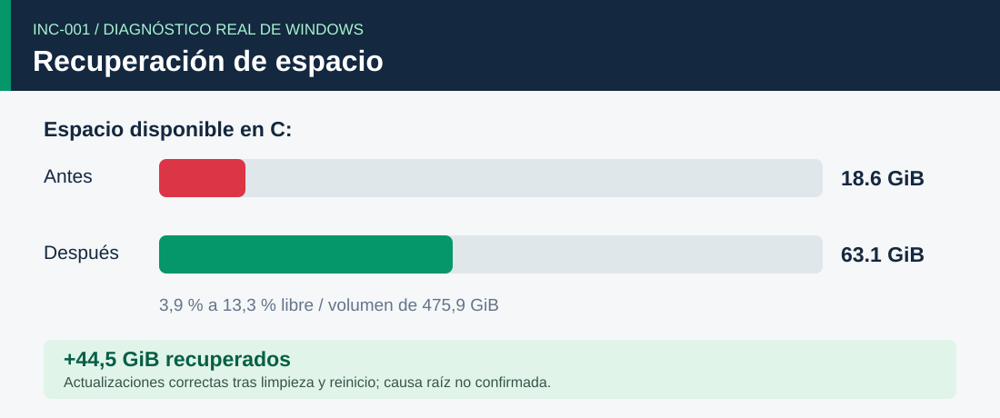
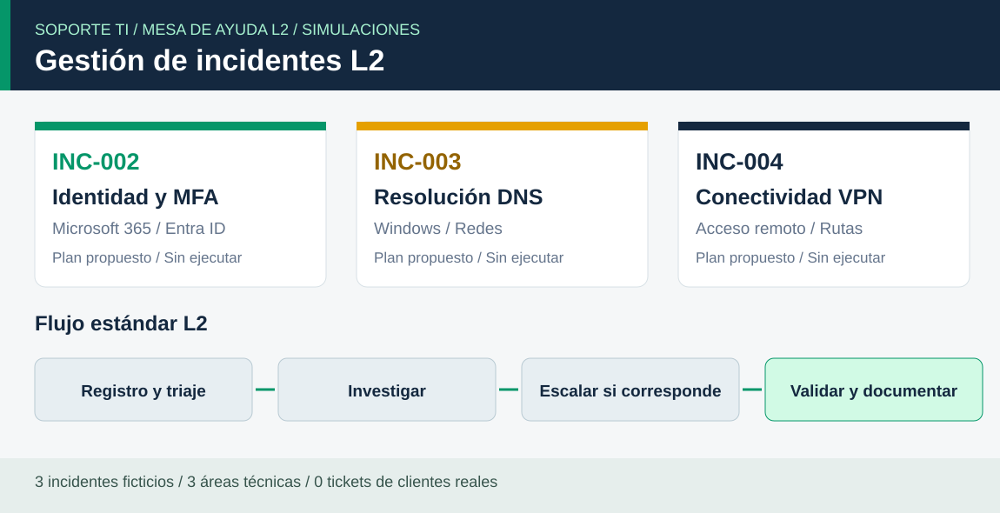
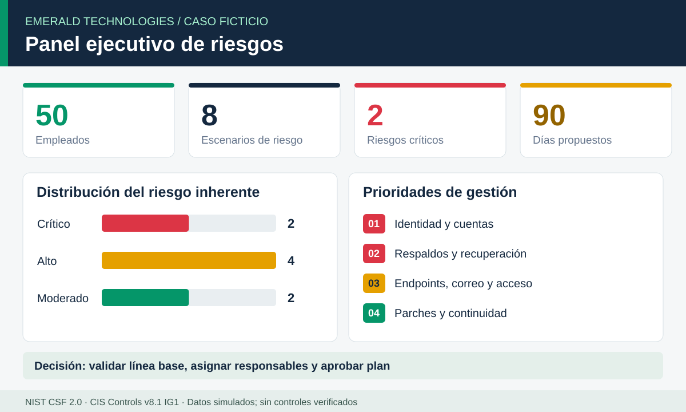
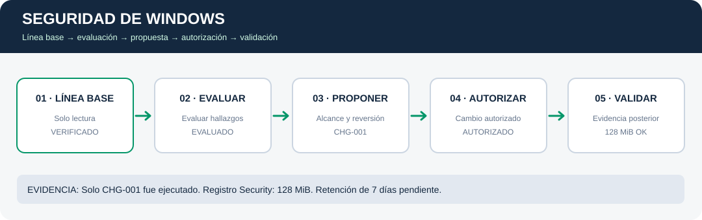

# Portafolio de Soporte TI, Administración de Sistemas y Ciberseguridad

**Fefe Mora · Soporte TI L1/L2 · Administración de sistemas · Seguridad de la información · Ciberseguridad**

   

**[English version / Versión en inglés](https://github.com/fefemora/it-portfolio-en)**

Trabajo en soporte TI, administración de sistemas y seguridad. Buena parte de mi experiencia consiste en diagnosticar problemas, ayudar a los usuarios a recuperar sus herramientas de trabajo y mantener los servicios funcionando. En este portafolio reúno ese trabajo con investigaciones prácticas de seguridad, documentación técnica y evaluación de riesgos.

Mis proyectos muestran **qué comprobé, qué encontré y qué pude verificar**. Algunos recogen investigaciones reales en estaciones de trabajo; otros son simulaciones claramente identificadas, utilizadas para explicar decisiones técnicas sin presentarlas como experiencia en producción.

## Explorar por área

| Área | Contenido |
|---|---|
| [ **Soporte TI y diagnóstico**](IT-Support/README.md) | Diagnóstico real de Windows y tres escenarios de mesa de ayuda L2 |
| [ **Ciberseguridad**](Cybersecurity/README.md) | Análisis de eventos de Windows, [triaje de SSH](Cybersecurity/Raspberry-Pi-SSH-Authentication-Triage/README.md) y seguridad de endpoints |
| [ **Seguridad de la información / GRC**](Information-Security/Enterprise-Risk-Assessment/README.md) | Evaluación de riesgos ficticia basada en NIST CSF 2.0 y CIS Controls |
| [ **Administración de sistemas**](Systems-Administration/README.md) | Windows Server, Active Directory y gestión de identidades |
| [ **Redes y conectividad**](Networking/README.md) | [Diagnóstico DNS con Raspberry Pi](Networking/Raspberry-Pi-DNS-Lab/README.md), VPN y conectividad |
| [ **Redes y seguridad cloud**](Cloud/README.md) | Azure, control de acceso y desarrollo de competencias en redes híbridas |
| [ **Documentación técnica**](Documentation/README.md) | Informes de incidentes, evidencia y procedimientos reutilizables |

## Proyectos destacados

###  INC-001 · Diagnóstico de Windows Update

  

Investigué fallos recurrentes de actualización de aplicaciones y el error `0x80073D02`. Tras liberar espacio y reiniciar, el almacenamiento disponible pasó de **18,6 GiB a 63,1 GiB**, y las actualizaciones finalizaron correctamente. El incidente quedó resuelto, aunque no fue posible aislar una causa raíz única.

[Leer el caso de diagnóstico](IT-Support/Windows-Troubleshooting-Lab/README.md)

###  Mesa de ayuda L2 · Identidad, DNS y VPN

 

Tres incidentes ficticios abordan la recuperación de MFA en Microsoft 365, fallos de resolución DNS y conexiones VPN sin acceso a recursos internos. Cada caso explica el razonamiento diagnóstico, los criterios de escalamiento y cómo se validaría una solución. **Los procedimientos no se ejecutaron en sistemas de clientes.**

[Explorar los incidentes L2](IT-Support/Service-Desk-Incident-Management/README.md)

###  Evaluación de riesgos de seguridad de la información

  

Desarrollé una evaluación cualitativa para una **organización ficticia de 50 personas**. Incluye inventario de activos, ocho escenarios de riesgo ilustrativos, propuestas de controles y un plan de tratamiento de 90 días. No se evaluó ninguna organización real ni la eficacia de controles implementados.

[Ver la evaluación de riesgos](Information-Security/Enterprise-Risk-Assessment/README.md)

###  Análisis de eventos de seguridad de Windows

 

Revisé eventos del registro Security, configuraciones de auditoría y una correlación acotada entre los eventos **4624 y 4672**. La medición mostró aproximadamente **2,03 días** de historial conservado y la auditoría de creación de procesos deshabilitada. **No se confirmó actividad maliciosa.**

[Revisar hallazgos y evidencias](Cybersecurity/Windows-Security-Event-Analysis/README.md)

###  Evaluación de seguridad y hardening de Windows

  

Completé **28 comprobaciones técnicas y dos etapas de evaluación y cierre** sobre firewall, Microsoft Defender, auditoría, PowerShell, BitLocker y seguridad de arranque. Un único cambio autorizado, **CHG-001**, aumentó el límite del registro Security de **20 MiB a 128 MiB**. Se verificó la nueva configuración; la retención de siete días y otras medidas de hardening siguen pendientes.

[Consultar la evaluación de seguridad](Cybersecurity/Windows-Security-Hardening/README.md)

## Competencias técnicas

| Área | Evidencias en el portafolio |
|---|---|
| **Windows y PowerShell** | Eventos, análisis de almacenamiento, comprobaciones del sistema y validación |
| **Soporte TI / Mesa de ayuda L2** | Priorización, diagnóstico, escalamiento y documentación de incidentes |
| **Microsoft 365 e identidades** | Investigación simulada de Entra ID y recuperación MFA |
| **Redes** | Procedimientos de diagnóstico DNS y VPN |
| **Operaciones de seguridad** | Análisis de eventos de Windows y líneas base de endpoints |
| **Seguridad de la información / GRC** | Registro de riesgos, mapeo de controles y plan de tratamiento |
| **Comunicación técnica** | Hallazgos, informes ejecutivos y límites de la evidencia |

## Próximos proyectos

Quiero seguir desarrollando este trabajo con laboratorios de **Active Directory e identidades**, diagnósticos de redes más profundos, **monitoreo SIEM** y **redes y seguridad cloud**. Son líneas de desarrollo, no casos prácticos completados.

## Tratamiento de evidencias

Cada proyecto diferencia **observaciones reales**, **escenarios simulados** y **cambios propuestos**. Indico las limitaciones cuando una prueba, una causa raíz o un resultado de seguridad no han podido confirmarse. Los ejemplos públicos excluyen credenciales e información confidencial de clientes.

---

**GitHub:** [github.com/fefemora](https://github.com/fefemora) · **Idioma:** [English](https://github.com/fefemora/it-portfolio-en)
